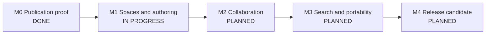

# Vibe Knowledge Development Storyboard

Last updated: 2026-10-18
Plan of record: [`IMPLEMENTATION_PLAN.md`](./IMPLEMENTATION_PLAN.md)  
Current release target: Release 1 — Safe, useful knowledge workspace

This is the living delivery record for Vibe Knowledge. The implementation plan
defines product scope and architecture; this storyboard records actual status,
acceptance evidence, release gates, risks, and the next executable work.

## Status rules

| Status        | Meaning                                                                                   |
| ------------- | ----------------------------------------------------------------------------------------- |
| `DONE`        | Implemented, tested, documented, and demonstrated against the stated acceptance behavior. |
| `PARTIAL`     | Useful verified behavior exists, but one or more acceptance conditions remain.            |
| `NEXT`        | Refined and ready to become the active vertical slice.                                    |
| `IN PROGRESS` | The one primary product story currently being implemented.                                |
| `PLANNED`     | Ordered but not ready or started.                                                         |
| `BLOCKED`     | Cannot progress without a named decision, dependency, or external change.                 |
| `DEFERRED`    | Deliberately outside the current release boundary.                                        |

No story becomes `DONE` from code completion alone. Relevant schema, domain,
API, UI, authorization, recovery, automated checks, browser evidence, and
documentation must agree.

## Current snapshot

| Item                 | Current state                                                                       |
| -------------------- | ----------------------------------------------------------------------------------- |
| Delivery gate        | `PGE-01` hierarchy gate is complete; `KNW-22` is the next bounded M1 slice          |
| Current milestone    | M1 — Spaces and authoring                                                           |
| Active product story | `EDT-01` — Accessible authoring with the frozen Release 1 schema                    |
| Active execution     | `KNW-22` is selected next; no editor implementation branch has started              |
| Blocking issues      | None                                                                                |
| Story roll-up        | 3 done, 3 partial, 0 in progress, 6 planned                                         |
| Release readiness    | Not ready; no release candidate exists                                              |
| Running path         | `docker compose up --build -d`; local Node/PostgreSQL development remains supported |

## Delivery storyline

| Milestone                   | Outcome                                                                                                                         | Status        | Exit gate                                                                             |
| --------------------------- | ------------------------------------------------------------------------------------------------------------------------------- | ------------- | ------------------------------------------------------------------------------------- |
| M0 — Publication proof      | A signed-in author creates a space and page, autosaves, publishes immutable revisions, detects conflict, compares, and restores | `DONE`        | Focused unit/integration/browser checks and clean Compose startup pass                |
| M1 — Spaces and authoring   | Teams organize permission-aware page trees and author the frozen Release 1 document schema                                      | `IN PROGRESS` | Hierarchy, editor round-trip, page restrictions, accessibility, and scale checks pass |
| M2 — Collaboration          | Teams discuss, mention, watch, and attach files safely                                                                          | `PLANNED`     | Exactly-once notifications and authorized scan/version/download paths pass            |
| M3 — Search and portability | Permitted knowledge is discoverable, templated, importable, exportable, and recoverable                                         | `PLANNED`     | Leakage, relevance, job, export, backup, and restore gates pass                       |
| M4 — Release candidate      | A secure, accessible, supportable Release 1 can be operated                                                                     | `PLANNED`     | Full quality, migration, browser, security, performance, and human gates pass         |

## Release 1 story board

| ID       | Story/outcome                                                           | Status    | Acceptance evidence or remaining work                                                                            |
| -------- | ----------------------------------------------------------------------- | --------- | ---------------------------------------------------------------------------------------------------------------- |
| `KNW-01` | Draft, publish, compare, and restore first slice                        | `DONE`    | Implementation, PostgreSQL, desktop, responsive, keyboard, and merged clean Compose evidence pass                |
| `FND-01` | Strict TypeScript workspaces, CI gate, and one-image runtime            | `PARTIAL` | Workspace gate and clean Compose app, worker, migration, seed, health, and object-store startup pass; CI remains |
| `IAM-01` | Development login and provider-neutral production OIDC                  | `PARTIAL` | Signed development sessions and database revocation exist; user administration and OIDC remain                   |
| `SPC-01` | Space membership and restrictive page inheritance                       | `DONE`    | `KNW-14`–`KNW-17` and PRs #5–#8 are merged; canonical story `KNW-11` is reconciled Done                          |
| `PGE-01` | Concurrent page tree create, move, reorder, archive, trash, and restore | `DONE`    | `KNW-18`–`KNW-21` and PRs #9, #11, #13, and #15 are merged with exact PostgreSQL, load, and browser evidence     |
| `EDT-01` | Accessible editor for the frozen Release 1 schema                       | `PARTIAL` | Contract confirmed; minimal schema/autosave/keyboard behavior works; `KNW-22`–`KNW-25` remain                    |
| `COL-01` | Page and inline comments, mentions, watches, and notifications          | `PLANNED` | Re-anchor/orphan behavior and deduplicated fan-out pass                                                          |
| `ATT-01` | Private scanned and versioned attachments                               | `PLANNED` | Authorization, quarantine, preview allowlist, replacement, and retention pass                                    |
| `SRC-01` | Permission-filtered PostgreSQL search and link graph                    | `PLANNED` | Counts, snippets, suggestions, backlinks, and stale-index cases reveal nothing restricted                        |
| `TPL-01` | Versioned templates and bounded first-party macros                      | `PLANNED` | Deterministic render, complexity, permission, and migration checks pass                                          |
| `PRT-01` | Markdown import, portable exports, and durable jobs                     | `PLANNED` | Dry run, idempotency, partial errors, archive manifest, and backpressure pass                                    |
| `PRD-01` | Release hardening and operations                                        | `PLANNED` | Accessibility, load, migration, recovery, rollback, documentation, and image scans pass                          |

## Confirmed M1 execution

The confirmed M1 story contract is
[`docs/m1-spaces-and-authoring-contract.md`](./docs/m1-spaces-and-authoring-contract.md).
Vibe JIRA epic `KNW-9` contains the documentation issue `KNW-10`, canonical
stories `KNW-11`–`KNW-13`, and their bounded execution issues `KNW-14`–`KNW-25`.

| Order | Canonical story | Vibe JIRA | Outcome                                                           |
| ----- | --------------- | --------- | ----------------------------------------------------------------- |
| 0     | M1 contract     | `KNW-10`  | Record confirmed decisions, source-of-truth changes, and ADRs     |
| 1     | `SPC-01`        | `KNW-11`  | Private membership and non-leaking restrictive page inheritance   |
| 2     | `PGE-01`        | `KNW-12`  | Concurrent, durable, reversible permission-aware page hierarchies |
| 3     | `EDT-01`        | `KNW-13`  | Safe, lossless, accessible authoring for the frozen Release 1 AST |

Only one execution issue, GitHub branch, and pull request is active at a time.
No M1 product story advances from its current `PARTIAL` state until its required
implementation and evidence issues are complete.

## Completed story: KNW-01

User outcome: a development user creates a space and child page, edits a
versioned heading-and-paragraph document, sees autosave state, publishes twice,
compares revisions, and restores revision 1 as revision 3.

Required behavior:

- Local authentication is explicitly development-only and uses a signed,
  HTTP-only session.
- Organization and space capabilities are enforced in server repositories.
- Every untrusted request and structured document is runtime validated.
- Draft autosave detects stale writes; publish detects a stale base revision.
- Publication and restore atomically update the page head, immutable revision,
  audit event, and outbox event.
- Internal IDs and tenant ownership are server-derived and checked.
- The minimal document renderer does not accept arbitrary HTML.
- Refresh preserves the canonical draft and published revision history.

Non-goals:

- Rich editor extensions beyond heading and paragraph
- Realtime collaboration, comments, attachments, macros, import, or export
- Anonymous access, guest links, additive page grants, or Vibe JIRA embeds

## Known risks

| Risk                                                | Current mitigation                                                                                     |
| --------------------------------------------------- | ------------------------------------------------------------------------------------------------------ |
| Rich-editor choices distort the foundation          | Prove a versioned minimal document and keep editor integration behind a package boundary               |
| Autosave is confused with publication               | Separate draft and immutable revision tables plus explicit UI states                                   |
| Authorization leaks through future projections      | Keep tenant/capability evaluation in repository boundaries and add adversarial fixtures per projection |
| Sibling applications become coupled through storage | Separate databases and migrations; share only external identity claims and stable URLs                 |
| Release scope outgrows evidence                     | One active product story and milestone exit gates limit work in progress                               |

## Decision log

| Date       | Decision                                                                                                                                                                                                                                                                                                                                |
| ---------- | --------------------------------------------------------------------------------------------------------------------------------------------------------------------------------------------------------------------------------------------------------------------------------------------------------------------------------------- |
| 2026-10-15 | Approved the twelve defaults in plan §20: hosted-ready self-hosting, single-organization Release 1, generic OIDC, explicit publish, bounded editor schema, Markdown-first import, restrictive page inheritance, no guests, safe image/PDF previews, realtime and Jira links in Release 2, and portable container production.            |
| 2026-10-15 | Vibe Knowledge is a separately deployable sibling with its own database and migrations; it may share an OIDC provider but never reads Vibe JIRA's database.                                                                                                                                                                             |
| 2026-10-18 | Confirmed M1 decisions Q1–Q38: deliver `SPC-01` → `PGE-01` → `EDT-01`; use private direct-membership spaces and restrictive inherited page access; preserve private drafts, durable aliases, atomic subtree lifecycle, a library-independent frozen editor schema, and explicit evidence gates. See the M1 contract and ADRs 0002–0004. |

## Evidence log

| Date       | Evidence                                                                                                                                                                                                                                                                                                                                                                                                                                                                                                                                                                                                                                                                                                                                                                                                                                                                                                                                                                                                                                                                           |
| ---------- | ---------------------------------------------------------------------------------------------------------------------------------------------------------------------------------------------------------------------------------------------------------------------------------------------------------------------------------------------------------------------------------------------------------------------------------------------------------------------------------------------------------------------------------------------------------------------------------------------------------------------------------------------------------------------------------------------------------------------------------------------------------------------------------------------------------------------------------------------------------------------------------------------------------------------------------------------------------------------------------------------------------------------------------------------------------------------------------- |
| 2026-10-15 | Created the living storyboard and moved `KNW-01` into progress. No implementation gate is claimed yet.                                                                                                                                                                                                                                                                                                                                                                                                                                                                                                                                                                                                                                                                                                                                                                                                                                                                                                                                                                             |
| 2026-10-16 | Implemented the first executable publication path. Formatting, lint, strict types, four unit tests, the production build, migration `0001`, and two real-PostgreSQL integration tests pass, including unpublished-draft isolation. Compose startup remains required before `KNW-01` can be completed.                                                                                                                                                                                                                                                                                                                                                                                                                                                                                                                                                                                                                                                                                                                                                                              |
| 2026-10-16 | Browser-verified development sign-in, space creation, parent/child page creation, debounced autosave, refresh persistence, two publications, structural/plain-text comparison, and restore of revision 1 as revision 3 at desktop and 390 × 844 responsive widths; keyboard focus moved from Publish to the title field.                                                                                                                                                                                                                                                                                                                                                                                                                                                                                                                                                                                                                                                                                                                                                           |
| 2026-10-16 | Production container verification remains open: two builds reached Docker BuildKit but failed on external registry networking (`ECONNRESET`, then Docker Hub `no route to host`). No container gate is claimed.                                                                                                                                                                                                                                                                                                                                                                                                                                                                                                                                                                                                                                                                                                                                                                                                                                                                    |
| 2026-10-17 | On the isolated `projectweave-knw8-gate` Compose project, a fresh build and startup completed: PostgreSQL and the SeaweedFS S3 API became healthy, migration `0001` and the seed job exited 0, the app and worker stayed running, `/health/live` and `/health/ready` returned 200, the login page and seeded login returned 200, and `npm run check` passed. KNW-01 remains in progress until review and merge.                                                                                                                                                                                                                                                                                                                                                                                                                                                                                                                                                                                                                                                                    |
| 2026-10-17 | Reviewed and merged GitHub pull request [#2](https://github.com/TJ-Engineer/ProjectWeave-Studio/pull/2) as `8448d4e`. Review added a signed AWS SigV4 `ListBuckets` check that returned 200 against the configured SeaweedFS S3 endpoint. With the final Compose change on `main`, `KNW-01` and M0 satisfy their recorded exit gates.                                                                                                                                                                                                                                                                                                                                                                                                                                                                                                                                                                                                                                                                                                                                              |
| 2026-10-18 | Created Vibe JIRA M1 epic `KNW-9`, documentation issue `KNW-10`, canonical stories `KNW-11`–`KNW-13`, and bounded execution issues `KNW-14`–`KNW-25`. Opened GitHub PR [#4](https://github.com/TJ-Engineer/ProjectWeave-Studio/pull/4) from `docs/knw-10-m1-contract` after `npm run check` passed, and moved only `KNW-10` to Review. No M1 implementation or release gate is claimed.                                                                                                                                                                                                                                                                                                                                                                                                                                                                                                                                                                                                                                                                                            |
| 2026-10-18 | Merged GitHub PR [#4](https://github.com/TJ-Engineer/ProjectWeave-Studio/pull/4) as `3849e9b`, moved `KNW-10` to Done and `KNW-11` to Selected, then started `KNW-14` on `feat/knw-14-access-data-model`.                                                                                                                                                                                                                                                                                                                                                                                                                                                                                                                                                                                                                                                                                                                                                                                                                                                                          |
| 2026-10-18 | Added forward-only migration `0002` and a real-PostgreSQL M0-upgrade fixture. `npm run check` passes, including formatting, lint, strict types, four unit tests, and the production build; four PostgreSQL integration tests pass separately. The fixture preserves M0 data and proves slug backfill, active-member checks, restriction pruning, and last-admin protection. No `SPC-01` completion or M1 release gate is claimed.                                                                                                                                                                                                                                                                                                                                                                                                                                                                                                                                                                                                                                                  |
| 2026-10-18 | Opened GitHub PR [#5](https://github.com/TJ-Engineer/ProjectWeave-Studio/pull/5) from `feat/knw-14-access-data-model` at feature commit `513cfbd`, reconciled the branch and verification evidence in Vibe JIRA, and moved `KNW-14` to Review. `SPC-01` remains in progress and no M1 release gate is claimed.                                                                                                                                                                                                                                                                                                                                                                                                                                                                                                                                                                                                                                                                                                                                                                     |
| 2026-10-18 | Merged GitHub PR [#5](https://github.com/TJ-Engineer/ProjectWeave-Studio/pull/5) as `6cb7a1c`, moved `KNW-14` to Done, and started `KNW-15` on `feat/knw-15-effective-access`. The effective-access slice derives policy from persisted identity and membership state, intersects ancestor restrictions, keeps unpublished work principal-private, validates route parameters, and authorizes idempotent retries before replay.                                                                                                                                                                                                                                                                                                                                                                                                                                                                                                                                                                                                                                                    |
| 2026-10-18 | Verified `KNW-15`: `npm run check` passes formatting, lint, strict types, eight non-database tests, and the production build; migration `0003` applies after `0001` and `0002`; five PostgreSQL integration tests pass against `knowledge_test`, including clean/upgrade migration paths and the adversarial effective-access fixture. No `SPC-01` completion or M1 release gate is claimed.                                                                                                                                                                                                                                                                                                                                                                                                                                                                                                                                                                                                                                                                                       |
| 2026-10-18 | Opened GitHub PR [#6](https://github.com/TJ-Engineer/ProjectWeave-Studio/pull/6) from `feat/knw-15-effective-access` at feature commit `1128a34`, added the exact branch, migration, permission, and test evidence to Vibe JIRA, and moved `KNW-15` to Review. `KNW-16` and `KNW-17` remain required before any `SPC-01` completion claim.                                                                                                                                                                                                                                                                                                                                                                                                                                                                                                                                                                                                                                                                                                                                         |
| 2026-10-18 | Review of PR [#6](https://github.com/TJ-Engineer/ProjectWeave-Studio/pull/6) found and corrected missing space-key path validation in `e150f24`; the full gate then passed with eight non-database tests. Merged PR #6 as `003be52`, moved `KNW-15` to Done, and started `KNW-16` on `feat/knw-16-access-admin`. `SPC-01` remains in progress.                                                                                                                                                                                                                                                                                                                                                                                                                                                                                                                                                                                                                                                                                                                                     |
| 2026-10-18 | Implemented the active `KNW-16` slice on `feat/knw-16-access-admin`: migration `0004`, version-checked member and page-policy APIs, bounded active-member pickers, last-admin/unpublished-owner guards, atomic grant pruning with audit/outbox evidence, and accessible administration screens. `npm run check` passes with nine non-database tests; seven PostgreSQL tests pass; desktop, 320 CSS-pixel, keyboard, and live-revocation browser checks pass. No review or completion is claimed yet.                                                                                                                                                                                                                                                                                                                                                                                                                                                                                                                                                                               |
| 2026-10-18 | Reconciled the `KNW-16` acceptance criteria and opened GitHub PR [#7](https://github.com/TJ-Engineer/ProjectWeave-Studio/pull/7) from `feat/knw-16-access-admin` at `05bc337`. Review found no merge-blocking defect; the PR records permission, migration, concurrency, recovery, automated, responsive, keyboard, and live-revocation evidence. `KNW-17` remains the separate `SPC-01` evidence gate, so no story or M1 completion is claimed.                                                                                                                                                                                                                                                                                                                                                                                                                                                                                                                                                                                                                                   |
| 2026-10-18 | Merged GitHub PR [#7](https://github.com/TJ-Engineer/ProjectWeave-Studio/pull/7) as `99889ec`, moved `KNW-16` to Done, and started `KNW-17` on `test/knw-17-adversarial-access-evidence`. Evidence exposed reactivation and stale-page-policy gaps: migration `0005` now prunes memberships/grants during emergency deactivation, advances membership and affected page-policy versions, permits the emergency last-admin override, seals private work, and requires explicit restoration; normal removal also advances affected page policies. `npm run check` passes formatting, lint, strict types, nine non-database tests, and the production build. Five real-PostgreSQL integration files and nine tests pass after fresh migrations `0001`–`0005`. Desktop and 320 CSS-pixel browser checks pass with keyboard member/restriction operations, bounded responsive layouts, and live revocation that clears the editor, redirects, advances policy, and does not revive grants on re-add. No review or completion is claimed yet.                                            |
| 2026-10-18 | Opened GitHub PR [#8](https://github.com/TJ-Engineer/ProjectWeave-Studio/pull/8) from `test/knw-17-adversarial-access-evidence` at implementation commit `80197ae` and moved `KNW-17` to Review. The pull request records the adversarial role/content matrix, emergency deactivation and re-add behavior, stale-version conflicts, complete automated gates, responsive and keyboard checks, and live editor revocation evidence. No `SPC-01` completion is claimed before review, merge, and Vibe JIRA reconciliation.                                                                                                                                                                                                                                                                                                                                                                                                                                                                                                                                                           |
| 2026-10-18 | Reviewed and merged GitHub PR [#8](https://github.com/TJ-Engineer/ProjectWeave-Studio/pull/8) as `46062a9`; moved `KNW-17` and canonical story `KNW-11` to Done after reconciling all four execution gates. Selected `KNW-12` and started `KNW-18` on `feat/knw-18-versioned-hierarchy`. Migration `0006` adds snapshot-consistent bounded tree/breadcrumb reads, per-sibling-list versions, administrator-only atomic move/reorder with cycle, cross-space, neighbor, and stable-version conflicts, no-broadening restriction materialization, deterministic destination-only rank rebalance, and content-free audit/outbox evidence. `npm run check` passes formatting, lint, strict types, ten non-database tests, and the production build; six real-PostgreSQL files and twelve tests pass. Review and a pull request remain before any `KNW-18` completion claim.                                                                                                                                                                                                            |
| 2026-10-18 | Opened GitHub PR [#9](https://github.com/TJ-Engineer/ProjectWeave-Studio/pull/9) from `feat/knw-18-versioned-hierarchy` at `a7f5540` and moved `KNW-18` to Review. The pull request records migration, authorization, access-preservation, bounded-tree, concurrency, rank-rebalance, audit/outbox, automated-check, and recovery evidence. No `KNW-18` or `PGE-01` completion is claimed before review, merge, and Vibe JIRA reconciliation.                                                                                                                                                                                                                                                                                                                                                                                                                                                                                                                                                                                                                                      |
| 2026-10-18 | Reviewed and merged GitHub PR [#9](https://github.com/TJ-Engineer/ProjectWeave-Studio/pull/9) as `8a70012` and moved `KNW-18` to Done with the migration, API, concurrency, authorization, access-preservation, recovery, and exact automated evidence retained in Vibe JIRA. `PGE-01` remains In Progress: `KNW-19` is next, and no `PGE-01` or M1 completion is claimed.                                                                                                                                                                                                                                                                                                                                                                                                                                                                                                                                                                                                                                                                                                         |
| 2026-10-18 | Implemented the active `KNW-19` slice on `feat/knw-19-durable-lifecycle`: migrations `0007`–`0009` add lifecycle-aware policy reads, independent inactive-subtree roots, and retained sibling anchors; publishing and revision restore reserve every current and historical alias under serialized deterministic slug allocation; versioned archive, trash, and restore preserve access, drafts, revisions, hierarchy, and content-free audit/outbox evidence without permanent deletion. `npm run check` passes formatting, lint, strict types, eleven non-database tests, and the production build; seven real-PostgreSQL files and eighteen tests pass. The historical-alias redirect and authorized archived read-only page pass desktop and 320 CSS-pixel inspection, with keyboard focus retaining an accessible brand name. Review and a pull request remain before any `KNW-19`, `PGE-01`, or M1 completion claim.                                                                                                                                                         |
| 2026-10-18 | Opened GitHub PR [#11](https://github.com/TJ-Engineer/ProjectWeave-Studio/pull/11) from `feat/knw-19-durable-lifecycle` at `b2bf1c5` and moved `KNW-19` to Review. The pull request records durable-alias, deterministic-collision, atomic lifecycle, access-preservation, independent-subtree, relative-restore, retention, audit/outbox, automated-check, responsive, and keyboard evidence. No `KNW-19`, `PGE-01`, or M1 completion is claimed before review, merge, and Vibe JIRA reconciliation.                                                                                                                                                                                                                                                                                                                                                                                                                                                                                                                                                                              |
| 2026-10-18 | Reviewed and merged GitHub PR [#11](https://github.com/TJ-Engineer/ProjectWeave-Studio/pull/11) as `d98dd59` and moved `KNW-19` to Done after retaining the implementation, PostgreSQL, migration, authorization, concurrency, recovery, responsive, and keyboard evidence in Vibe JIRA. GitHub had no remote checks configured; the focused review found no merge-blocking defect and used the passing local gates recorded on the issue. `PGE-01` remains In Progress: `KNW-20` is next, `KNW-21` remains required, and no `PGE-01` or M1 completion is claimed.                                                                                                                                                                                                                                                                                                                                                                                                                                                                                                                 |
| 2026-10-18 | Implemented the active `KNW-20` slice on `feat/knw-20-accessible-page-tree`: the permission-filtered semantic tree lazily loads bounded children, paginates explicitly, preserves expansion and focus during load and administrator button-based reorder, and separates canonical published read mode from explicit editing. The server derives edit capability, withholds other principals' drafts, and rejects descendant publication until every ancestor is published. `npm run check` passes formatting, lint, strict types, eleven non-database tests, and the production build; eight PostgreSQL integration files and twenty-one tests pass against `knowledge_test`. Browser evidence covers administrator, editor, and viewer projections; Arrow-key traversal; 50-plus-2 child pagination; focus-preserving non-drag movement; read/edit routing; hidden-draft absence; and no horizontal overflow at 320 CSS pixels with 40-pixel primary controls. Review and a pull request remain before any `KNW-20`, `PGE-01`, or M1 completion claim; `KNW-21` remains required. |
| 2026-10-18 | Opened GitHub PR [#13](https://github.com/TJ-Engineer/ProjectWeave-Studio/pull/13) from `feat/knw-20-accessible-page-tree` at implementation commit `9ebf4af`, reconciled the exact automated and browser evidence in Vibe JIRA, and moved `KNW-20` to Review. The pull request is mergeable with no remote checks configured; a focused review found no merge-blocking authorization, hierarchy, read/edit, state-preservation, or accessibility defect. No `KNW-20`, `PGE-01`, or M1 completion is claimed before merge and final reconciliation; `KNW-21` remains required.                                                                                                                                                                                                                                                                                                                                                                                                                                                                                                     |
| 2026-10-18 | Reviewed and merged GitHub PR [#13](https://github.com/TJ-Engineer/ProjectWeave-Studio/pull/13) as `2f0e4dd` and reconciled `KNW-20` Done after retaining the permission-filtering, private-draft isolation, ancestor-publication, incremental-tree, keyboard, non-drag, read/edit, automated, desktop, and 320 CSS-pixel evidence. `PGE-01` remains In Progress: `KNW-21` is the final hierarchy evidence gate, and no `PGE-01` or M1 completion is claimed.                                                                                                                                                                                                                                                                                                                                                                                                                                                                                                                                                                                                                      |
| 2026-10-18 | Started `KNW-21` on `test/knw-21-hierarchy-evidence`. The expanded hierarchy suite independently proves stale source and destination rejection with no partial movement or audit effect; eight PostgreSQL integration files and twenty-two tests pass. A real 10,000-page/1,000-sibling load fixture exposed and then regression-covered recursive per-sibling authorization: the set-based permission-preserving query now measures 10.1 ms first-page tree p95, 12.5 ms late-page tree p95, 2.3 ms published-read p95, and 12.4 ms maximum for the initial ten-page traversal over 25 samples. Browser evidence, the full application gate, review, and merge remain before `KNW-21` or `PGE-01` completion.                                                                                                                                                                                                                                                                                                                                                                     |
| 2026-10-18 | Completed the pre-review `KNW-21` gate: `npm run check` passes formatting, lint, strict types, eleven non-database tests, and the production build; eight PostgreSQL integration files and twenty-two tests pass; and the two-test scale/load gate passes. Desktop and 320 CSS-pixel browser evidence covers 50-plus-2 pagination, Arrow-key focus, 40-pixel pointer controls, keyboard page opening, zero horizontal overflow, viewer read mode, capability-gated Edit, administrator non-drag reorder with focus retention, and normal title-free 404 boundaries for restricted, private-draft, edit, and invalid-UUID routes. Review and merge remain before `KNW-21`, canonical story `KNW-12`, or `PGE-01` completion.                                                                                                                                                                                                                                                                                                                                                        |
| 2026-10-18 | Opened GitHub PR [#15](https://github.com/TJ-Engineer/ProjectWeave-Studio/pull/15) from `test/knw-21-hierarchy-evidence` at implementation commit `eb23354`, reconciled the exact concurrency, recovery, authorization, scale, automated, desktop, and 320 CSS-pixel evidence in Vibe JIRA, and moved `KNW-21` to Review. The pull request is mergeable with no remote checks configured; a focused review found no merge-blocking hierarchy, lifecycle, authorization, route-boundary, performance, or accessibility defect. No `KNW-21`, canonical story `KNW-12`, `PGE-01`, or M1 completion is claimed before merge and final reconciliation.                                                                                                                                                                                                                                                                                                                                                                                                                                  |
| 2026-10-18 | Reviewed and merged GitHub PR [#15](https://github.com/TJ-Engineer/ProjectWeave-Studio/pull/15) as `0c5de14`. The merged gate retains cycle, independent stale-list, competing-administrator, deterministic-rebalance, durable-alias, lifecycle-recovery, restriction-preservation, non-disclosure, 10,000-page/1,000-sibling load, desktop, responsive, keyboard, and non-drag evidence. `KNW-21`, canonical story `KNW-12`, and `PGE-01` advance to Done after final Vibe JIRA reconciliation; `EDT-01` and `KNW-22` are next, while M1 remains In Progress.                                                                                                                                                                                                                                                                                                                                                                                                                                                                                                                     |
