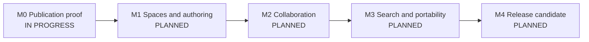

# Vibe Knowledge Development Storyboard

Last updated: 2026-10-16  
Plan of record: [`IMPLEMENTATION_PLAN.md`](./IMPLEMENTATION_PLAN.md)  
Current release target: Release 1 — Safe, useful knowledge workspace

This is the living delivery record for Vibe Knowledge. The implementation plan
defines product scope and architecture; this storyboard records actual status,
acceptance evidence, release gates, risks, and the next executable work.

## Status rules

| Status        | Meaning                                                                                   |
| ------------- | ----------------------------------------------------------------------------------------- |
| `DONE`        | Implemented, tested, documented, and demonstrated against the stated acceptance behavior. |
| `PARTIAL`     | Useful verified behavior exists, but one or more acceptance conditions remain.            |
| `NEXT`        | Refined and ready to become the active vertical slice.                                    |
| `IN PROGRESS` | The one primary product story currently being implemented.                                |
| `PLANNED`     | Ordered but not ready or started.                                                         |
| `BLOCKED`     | Cannot progress without a named decision, dependency, or external change.                 |
| `DEFERRED`    | Deliberately outside the current release boundary.                                        |

No story becomes `DONE` from code completion alone. Relevant schema, domain,
API, UI, authorization, recovery, automated checks, browser evidence, and
documentation must agree.

## Current snapshot

| Item                 | Current state                                                                                           |
| -------------------- | ------------------------------------------------------------------------------------------------------- |
| Delivery gate        | M0 architecture proof is in progress                                                                    |
| Current milestone    | M0 — Safe publication foundation                                                                        |
| Active product story | `KNW-01` Draft, publish, compare, and restore first slice                                               |
| Blocking issues      | Docker Desktop cannot currently reach Docker Hub; production-image verification is pending              |
| Story roll-up        | 0 done, 5 partial, 1 in progress, 6 planned                                                             |
| Release readiness    | Not ready; no release candidate exists                                                                  |
| Running path         | `npm run db:migrate` → `npm run db:seed` → `npm run dev`; Compose is defined but awaits registry access |

## Delivery storyline

| Milestone                   | Outcome                                                                                                                         | Status        | Exit gate                                                                             |
| --------------------------- | ------------------------------------------------------------------------------------------------------------------------------- | ------------- | ------------------------------------------------------------------------------------- |
| M0 — Publication proof      | A signed-in author creates a space and page, autosaves, publishes immutable revisions, detects conflict, compares, and restores | `IN PROGRESS` | Focused unit/integration/browser checks and clean Compose startup pass                |
| M1 — Spaces and authoring   | Teams organize permission-aware page trees and author the frozen Release 1 document schema                                      | `PLANNED`     | Hierarchy, editor round-trip, page restrictions, accessibility, and scale checks pass |
| M2 — Collaboration          | Teams discuss, mention, watch, and attach files safely                                                                          | `PLANNED`     | Exactly-once notifications and authorized scan/version/download paths pass            |
| M3 — Search and portability | Permitted knowledge is discoverable, templated, importable, exportable, and recoverable                                         | `PLANNED`     | Leakage, relevance, job, export, backup, and restore gates pass                       |
| M4 — Release candidate      | A secure, accessible, supportable Release 1 can be operated                                                                     | `PLANNED`     | Full quality, migration, browser, security, performance, and human gates pass         |

## Release 1 story board

| ID       | Story/outcome                                                           | Status        | Acceptance evidence or remaining work                                                                                     |
| -------- | ----------------------------------------------------------------------- | ------------- | ------------------------------------------------------------------------------------------------------------------------- |
| `KNW-01` | Draft, publish, compare, and restore first slice                        | `IN PROGRESS` | Local, PostgreSQL, desktop, responsive, and keyboard evidence passes; clean Compose startup remains                       |
| `FND-01` | Strict TypeScript workspaces, CI gate, and one-image runtime            | `PARTIAL`     | Workspace gate, standalone build/start, health, migration, seed, and worker exist; clean Compose/CI remain                |
| `IAM-01` | Development login and provider-neutral production OIDC                  | `PARTIAL`     | Development login uses signed HTTP-only sessions and origin checks; deactivation and OIDC remain                          |
| `SPC-01` | Space membership and restrictive page inheritance                       | `PARTIAL`     | Space capabilities and private unpublished drafts pass PostgreSQL tests; restrictive inheritance remains                  |
| `PGE-01` | Concurrent page tree create, move, reorder, archive, trash, and restore | `PARTIAL`     | Root/child creation and durable ID routes work; move, reorder, archive, trash, restore, and scale remain                  |
| `EDT-01` | Accessible editor for the frozen Release 1 schema                       | `PARTIAL`     | Versioned heading/paragraph schema, safe rendering, autosave states, and responsive keyboard UI pass; full schema remains |
| `COL-01` | Page and inline comments, mentions, watches, and notifications          | `PLANNED`     | Re-anchor/orphan behavior and deduplicated fan-out pass                                                                   |
| `ATT-01` | Private scanned and versioned attachments                               | `PLANNED`     | Authorization, quarantine, preview allowlist, replacement, and retention pass                                             |
| `SRC-01` | Permission-filtered PostgreSQL search and link graph                    | `PLANNED`     | Counts, snippets, suggestions, backlinks, and stale-index cases reveal nothing restricted                                 |
| `TPL-01` | Versioned templates and bounded first-party macros                      | `PLANNED`     | Deterministic render, complexity, permission, and migration checks pass                                                   |
| `PRT-01` | Markdown import, portable exports, and durable jobs                     | `PLANNED`     | Dry run, idempotency, partial errors, archive manifest, and backpressure pass                                             |
| `PRD-01` | Release hardening and operations                                        | `PLANNED`     | Accessibility, load, migration, recovery, rollback, documentation, and image scans pass                                   |

## Active story: KNW-01

User outcome: a development user creates a space and child page, edits a
versioned heading-and-paragraph document, sees autosave state, publishes twice,
compares revisions, and restores revision 1 as revision 3.

Required behavior:

- Local authentication is explicitly development-only and uses a signed,
  HTTP-only session.
- Organization and space capabilities are enforced in server repositories.
- Every untrusted request and structured document is runtime validated.
- Draft autosave detects stale writes; publish detects a stale base revision.
- Publication and restore atomically update the page head, immutable revision,
  audit event, and outbox event.
- Internal IDs and tenant ownership are server-derived and checked.
- The minimal document renderer does not accept arbitrary HTML.
- Refresh preserves the canonical draft and published revision history.

Non-goals:

- Rich editor extensions beyond heading and paragraph
- Realtime collaboration, comments, attachments, macros, import, or export
- Anonymous access, guest links, additive page grants, or Vibe JIRA embeds

## Known risks

| Risk                                                | Current mitigation                                                                                     |
| --------------------------------------------------- | ------------------------------------------------------------------------------------------------------ |
| Rich-editor choices distort the foundation          | Prove a versioned minimal document and keep editor integration behind a package boundary               |
| Autosave is confused with publication               | Separate draft and immutable revision tables plus explicit UI states                                   |
| Authorization leaks through future projections      | Keep tenant/capability evaluation in repository boundaries and add adversarial fixtures per projection |
| Sibling applications become coupled through storage | Separate databases and migrations; share only external identity claims and stable URLs                 |
| Release scope outgrows evidence                     | One active product story and milestone exit gates limit work in progress                               |

## Decision log

| Date       | Decision                                                                                                                                                                                                                                                                                                                     |
| ---------- | ---------------------------------------------------------------------------------------------------------------------------------------------------------------------------------------------------------------------------------------------------------------------------------------------------------------------------- |
| 2026-10-15 | Approved the twelve defaults in plan §20: hosted-ready self-hosting, single-organization Release 1, generic OIDC, explicit publish, bounded editor schema, Markdown-first import, restrictive page inheritance, no guests, safe image/PDF previews, realtime and Jira links in Release 2, and portable container production. |
| 2026-10-15 | Vibe Knowledge is a separately deployable sibling with its own database and migrations; it may share an OIDC provider but never reads Vibe JIRA's database.                                                                                                                                                                  |

## Evidence log

| Date       | Evidence                                                                                                                                                                                                                                                                                                                 |
| ---------- | ------------------------------------------------------------------------------------------------------------------------------------------------------------------------------------------------------------------------------------------------------------------------------------------------------------------------ |
| 2026-10-15 | Created the living storyboard and moved `KNW-01` into progress. No implementation gate is claimed yet.                                                                                                                                                                                                                   |
| 2026-10-16 | Implemented the first executable publication path. Formatting, lint, strict types, four unit tests, the production build, migration `0001`, and two real-PostgreSQL integration tests pass, including unpublished-draft isolation. Compose startup remains required before `KNW-01` can be completed.                    |
| 2026-10-16 | Browser-verified development sign-in, space creation, parent/child page creation, debounced autosave, refresh persistence, two publications, structural/plain-text comparison, and restore of revision 1 as revision 3 at desktop and 390 × 844 responsive widths; keyboard focus moved from Publish to the title field. |
| 2026-10-16 | Production container verification remains open: two builds reached Docker BuildKit but failed on external registry networking (`ECONNRESET`, then Docker Hub `no route to host`). No container gate is claimed.                                                                                                          |
