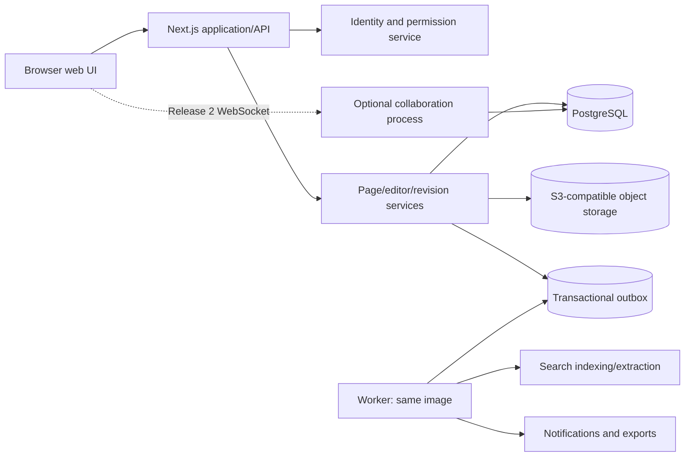

# Vibe Knowledge — Confluence-Inspired Implementation Plan

## 1. Product intent

Build a browser-based team knowledge workspace inspired by the useful parts of Confluence: structured spaces, hierarchical pages, a rich editor, durable revisions, comments, attachments, search, templates, and controlled sharing. It should be easier to operate and customize than a broad enterprise suite while remaining safe for important technical and organizational knowledge.

Working product name: **Vibe Knowledge**. “Confluence” describes the product category and migration target only. Before release, use original branding and do not copy Atlassian names, icons, proprietary UI, or visual assets.

### Product principles

1. Writing and finding knowledge are the two primary workflows.
2. A user should never be uncertain whether their work is saved.
3. Published revisions are immutable, attributable, comparable, and restorable.
4. Pages are structured documents, not blobs of unsafe HTML.
5. Permissions are understandable and enforced before data is queried or rendered.
6. Common actions remain in context: edit, comment, link, move, and inspect history.
7. AI may assist creation and discovery, but it never silently publish, overwrite, or broaden access.

## 2. Product and technology decisions

- Delivery model: responsive browser UI; no desktop application or browser extension is required.
- Packaging: one versioned Docker application image plus a supplied Docker Compose stack.
- Primary language: TypeScript in strict mode across UI, API, domain services, workers, and tests.
- Web stack: React with Next.js on Node.js.
- Database: PostgreSQL, initially including full-text search.
- Attachments: external S3-compatible object storage; never stored in the application image.
- Document source of truth: versioned structured JSON following a controlled editor schema.
- Editor direction: a ProseMirror-compatible React editor such as Tiptap, isolated behind an internal editor adapter.
- Realtime direction: Yjs-compatible CRDT collaboration after single-user draft and revision safety are proven.
- Initial tenancy: one organization per installation, while all tenant-owned data retains `organization_id`.
- Authentication: local development login plus production OIDC/OAuth integration.

### 2.1 Language policy

Use TypeScript for:

- React components and the rich editor integration
- API routes and service code
- permission and publication rules
- background jobs and content extraction
- import/export tools
- unit, integration, and browser tests

Use SQL deliberately for migrations, constraints, indexes, recursive page-tree queries, full-text search, and reporting. Use YAML for Docker Compose and CI. Keep shell scripts limited to small container entrypoints.

Required TypeScript settings include `strict`, `noImplicitAny`, and `strictNullChecks`. Runtime schemas must validate every request, import, editor document, environment variable, and queued event because compile-time types do not validate untrusted data.

## 3. Scope and release strategy

### Release 1 — Safe, useful knowledge workspace

A team can create spaces, author rich pages, organize them into a tree, publish and restore revisions, search content, collaborate through comments, and self-host the complete system with Docker.

Required capabilities:

- Organization, users, groups, and space membership
- Personal and team spaces
- Page tree with create, move, reorder, archive, and restore
- Rich structured editor with keyboard shortcuts and slash commands
- Draft autosave, explicit publish, version history, diff, and restore
- Page titles, stable IDs, editable slugs, and durable links
- Page links, backlinks, labels, mentions, and watchers
- Page and inline comments with resolution state
- Attachment upload, preview metadata, versioning, and download
- Search across title, body, labels, comments where permitted, and attachments with extracted text where supported
- Space and page permissions
- Templates
- Activity feed and in-app notifications
- PDF/HTML/Markdown export and documented CSV/HTML import boundary
- Administration, audit log, backup, and restore documentation
- Responsive, accessible web UI

### Release 2 — Live collaboration and richer knowledge tools

- Realtime multi-user editing with presence and remote cursors
- Offline/reconnection conflict handling through CRDT updates
- Whiteboards or canvas documents as a distinct document type
- Databases/content tables with typed properties and views
- Reusable page properties and roll-up reports
- Calendar and roadmap macros
- Public or guest links with expiry and explicit scope
- Email notifications and digests
- Webhooks, API tokens, and integrations
- JIRA/Vibe JIRA issue embeds and bidirectional links
- Richer analytics, stale-content review, ownership, and verification workflows
- Bulk page operations and advanced migration tools

### Release 3 — Enterprise and ecosystem

- Multi-organization SaaS tenancy
- SAML/OIDC SSO, SCIM, and lifecycle automation
- Data residency, retention, legal hold, and export controls
- Advanced audit and administrator analytics
- Cross-space governance and classification policies
- Sandboxed extension/macro SDK
- Dedicated search service when measured scale exceeds PostgreSQL search
- Mobile applications only if the PWA experience is insufficient

### Explicit non-goals for Release 1

- Pixel-for-pixel Confluence compatibility
- Arbitrary JavaScript macros
- Full Microsoft Office or Google Docs fidelity
- Anonymous public publishing by default
- Realtime collaborative editing before revision correctness is established
- AI-generated content that publishes without an explicit user action
- A general-purpose website builder

## 4. Primary users and critical journeys

### Reader

- Open a shared page and understand its location, author, freshness, and access level.
- Navigate through the page tree, links, backlinks, and search.
- Comment or ask a question without entering edit mode.

### Author

- Create a page from blank or a template.
- Write with headings, tables, task lists, code, images, and internal links.
- Leave and return without losing a draft.
- Publish, review the resulting revision, and share a durable link.

### Space administrator

- Create a space, define membership, configure defaults, and curate templates.
- Move or archive pages without breaking links.
- Review activity and restore deleted or previous content.

### Organization administrator

- Invite, deactivate, and group users.
- Define global policies and inspect audit events.
- Back up, upgrade, export, and restore the installation.

## 5. Functional specification

### 5.1 Spaces and page tree

- Every page belongs to one space and has an immutable UUID.
- A page may have one parent and ordered siblings.
- Moving a page moves its subtree and must prevent cycles.
- Reordering uses fractional ranks or another concurrency-safe ordering scheme.
- Slugs are readable aliases; links resolve through page ID so title or slug changes do not break references.
- Deleted pages enter a space trash. M1 provides restore without permanent
  deletion or automatic retention expiry; later administration work may add an
  operator-controlled retention policy.
- Archiving hides content from normal navigation without deleting history.
- Breadcrumbs show the current canonical path.
- Large page trees load incrementally and support keyboard navigation.

For M1, page UUIDs are canonical and every historical slug remains a reserved
alias. Tree requests return at most 100 nodes and must support a 10,000-page
space with 1,000 direct siblings. Move, reorder, archive, trash, and restore use
the authorization, subtree, and concurrency rules in
[`docs/m1-spaces-and-authoring-contract.md`](./docs/m1-spaces-and-authoring-contract.md).

Acceptance criteria:

- Moving or renaming a page preserves all existing internal links.
- A user cannot infer restricted page titles through navigation, search, backlinks, or API errors.
- Two administrators reordering siblings cannot silently lose either committed change.
- A subtree restore returns pages to a valid location even if the original parent no longer exists.

### 5.2 Rich document editor

The canonical body is structured JSON validated against an explicit, versioned editor schema. Derived HTML is sanitized and may be cached for display/search, but is never the only source of truth.

`@knowledge/editor` owns that canonical schema, its deterministic migrations,
safe rendering, and an adapter boundary for a Tiptap/ProseMirror-compatible UI.
Engine-specific JSON is not the persisted domain contract. The M1 safety
budgets and compatibility behavior are fixed in the
[`M1 spaces and authoring contract`](./docs/m1-spaces-and-authoring-contract.md).

Release 1 content nodes:

- Paragraphs, headings, bold, italic, underline, strike, and inline code
- Ordered, unordered, and task lists
- Links, internal page links, user mentions, and labels
- Block quotes, dividers, callouts, and status lozenges
- Tables with header rows and accessible navigation
- Fenced code blocks with language metadata
- Images and file attachments with captions and alt text
- Expand/collapse sections
- Table of contents generated from headings
- Dates and simple user/task references

Editor behavior:

- Slash command menu, markdown-style shortcuts, and paste handling
- Debounced autosave with visible Saving, Saved, Offline, and Error states
- Local recovery buffer for a failed network session
- Explicit publish action with optional change summary
- Preview rendered through the same schema and sanitization rules as published pages
- No arbitrary script, inline event handler, or unsandboxed embedded HTML
- Unknown future nodes remain recoverable during schema migration rather than being silently discarded

Service-backed nodes must validate, migrate, round-trip, and render safely in
M1 fixtures. Their creation controls remain disabled until the attachment,
collaboration, or integration story supplies the required authorized service.

### 5.3 Draft, publish, and revision model

- A draft is mutable working state associated with a page and principal.
- A published revision is immutable and contains body, title, author, timestamp, schema version, and change summary.
- Publication uses optimistic concurrency against the last known published revision.
- Conflicting publication never overwrites another revision silently.
- Restore creates a new revision copied from a historical one; it does not rewrite history.
- Autosaves are operational checkpoints, not user-visible published revisions.
- The revision diff renders meaningful structural changes and has a plain-text fallback.

Release 1 conflict flow:

1. Editor loads base revision N.
2. Another author publishes N+1.
3. First author attempts to publish against N.
4. Server rejects with a conflict response containing safe metadata.
5. M1 offers compare, copy/download changes, refresh, and manual
   reconciliation. Automatic structural merge is deferred.
6. A user explicitly confirms the final publication.

### 5.4 Realtime collaboration

Realtime collaboration is a Release 2 subsystem, not a shortcut around the revision model.

- Use a CRDT document per page draft with authenticated WebSocket connections.
- Persist incremental updates and periodically compact them into snapshots.
- Presence and cursors are ephemeral and never part of a published revision.
- Publishing creates a deterministic canonical editor document and immutable revision.
- Schema version negotiation must prevent an older client from corrupting newer nodes.
- Reconnection is idempotent and tested with out-of-order and duplicated updates.
- Authorization is checked at connection, document subscription, update, and publish boundaries.
- Keep a non-CRDT export snapshot so documents can be recovered independently of the collaboration service.

### 5.5 Comments and review

- Page comments are chronological discussions on the whole page.
- Inline comments anchor to editor positions plus quoted/context content so they can be re-anchored after edits.
- Threads support replies, mentions, resolve, reopen, edit, and soft delete.
- Orphaned inline comments remain accessible in the comments panel.
- Comment permissions are separate from page edit permissions.
- Notification fan-out respects watches, mentions, thread participants, and user preferences without duplication.

### 5.6 Attachments and media

- Objects live in private S3-compatible storage using non-guessable keys.
- Attachment metadata and versions live in PostgreSQL.
- Upload uses short-lived signed URLs or a streamed authenticated endpoint.
- Downloads re-check page permission even when the underlying object exists.
- Enforce size/type limits and malware scan state before general download.
- Replacing an attachment creates a new version rather than overwriting the object.
- Images require dimensions, safe preview generation, and author-supplied alt text prompts.
- Deleting a page does not immediately delete referenced attachment versions; retention cleanup is asynchronous and auditable.

### 5.7 Search and discovery

Release 1 uses PostgreSQL full-text search over a permission-filtered index.

Search fields and weighting:

- Highest: exact page title and aliases
- High: headings, labels, and space name
- Normal: body plain text
- Lower: comments and extracted attachment text

Filters:

- Space, author, contributor, label, content type, created date, updated date
- Owned by me, mentioned me, watched, recently viewed, and recently updated
- Archived content excluded by default

Requirements:

- Apply organization/space/page visibility before returning results, counts, snippets, or suggestions.
- Update the index asynchronously through an outbox while exposing predictable near-realtime behavior.
- Search snippets must be sanitized and must not reveal hidden adjacent content.
- Record zero-result queries and latency without logging private query content by default.
- Introduce a dedicated search engine only after measured relevance or scale requirements justify it.

### 5.8 Templates and controlled macros

- Templates are versioned structured documents scoped globally, to a space, or to a user.
- Template variables are typed and validated.
- Release 1 macros are first-party, declarative editor nodes rendered by trusted code.
- Initial macros: table of contents, children list, page properties, content by label, recent updates, user mention, status, and code block.
- Macro rendering has explicit time, size, and permission boundaries.
- A macro cannot fetch arbitrary network resources or execute user-provided JavaScript.
- Third-party macros wait for a sandboxed extension contract in Release 3.

### 5.9 Import and export

- Export a page or subtree to HTML, Markdown package, and PDF.
- Export a space to a portable archive with manifest, pages, revisions as configured, comments, attachments, labels, and relationships.
- Import is a background job with dry-run validation and a downloadable error report.
- Import sanitizes HTML, validates structured documents, and preserves unknown source data in a report.
- Generic HTML/Markdown import ships first; Confluence export mapping is a separate compatibility milestone.
- Every import is idempotent or explicitly detects a repeated archive.

## 6. Permission model

Use named capabilities rather than scattering role-name checks:

- `space:view`
- `page:view`
- `page:create`
- `page:edit`
- `page:publish`
- `page:move`
- `page:delete`
- `comment:create`
- `attachment:create`
- `space:admin`
- `audit:read`

Initial roles:

| Role               | Typical rights                                                         |
| ------------------ | ---------------------------------------------------------------------- |
| Organization admin | Manage organization, users, policies, all spaces, audit, and export    |
| Space admin        | Configure one space, members, templates, permissions, and trash        |
| Editor             | View, create, edit, publish, comment, and attach within allowed spaces |
| Commenter          | View and comment but not edit page content                             |
| Viewer             | Read allowed published content                                         |

M1 implements `ADMIN`, `EDITOR`, and `VIEWER` for private team spaces. The
`COMMENTER` role, personal spaces, and reusable groups remain Release 1
follow-up work owned by their collaboration or administration stories.

Permission precedence:

1. Organization suspension or user deactivation denies access.
2. Explicit restrictive page policy can narrow inherited space access.
3. Space membership grants the role capabilities available in that space.
4. Page restrictions may only narrow inherited access and are intersected down
   the subtree; a descendant cannot reopen access.
5. Drafts require edit access and ownership by the requesting principal.

All read paths—including tree navigation, search, backlinks, comments, attachment metadata, activity, exports, and realtime subscriptions—must enforce the same effective policy.

## 7. Proposed architecture

Start as a modular monolith with a separately runnable worker from the same Docker image.



Suggested modules:

- Identity, organization, groups, and membership
- Spaces and page hierarchy
- Editor schema and document rendering
- Drafts, publication, revisions, and diff
- Comments and mentions
- Attachments and media processing
- Permission evaluation
- Search and link graph
- Templates and macros
- Notifications and activity
- Import/export
- Audit and administration
- Realtime collaboration in Release 2

### Publication write path

1. Client sends page ID, base revision, validated structured body, title, and change summary.
2. Server authenticates and checks `page:publish` against current policy.
3. Editor schema validator rejects unsupported or unsafe content.
4. Service verifies the base revision and page state.
5. One database transaction creates the immutable revision, updates the page head, records activity/audit, updates internal link edges, and writes outbox events.
6. API returns the canonical published revision.
7. Worker updates search, notifications, exports/previews, and cache invalidation.

## 8. Docker delivery model

Release 1 produces one immutable application image. Different commands from the same image run the web server, migrations, seed data, worker, and later collaboration process.

Image requirements:

- Multi-stage production build using the framework's minimal standalone output
- Non-root runtime user
- Configurable listener on `0.0.0.0`, default port `3000`
- `/health/live` and `/health/ready` endpoints
- Graceful `SIGTERM` handling
- Structured logs to stdout/stderr
- Secrets only through environment/secrets mounts
- Read-only root filesystem compatibility with an explicit temporary path
- Image version and commit revision exposed through build information
- Dependency, license, and image vulnerability scanning in CI
- Explicit one-shot migrations before a new application version starts

Default Compose services:

```text
app              browser UI and API
worker           same image, background command
postgres         durable relational data and search index
object-storage   S3-compatible attachments and export artifacts
```

Release 2 may add `collaboration` from the same image and Redis only if measured coordination or queue needs require it.

Repository deliverables:

- `Dockerfile`
- `.dockerignore`
- `compose.yaml`
- development Compose profile/override with hot reload
- `.env.example` with safe placeholders
- health checks and dependency readiness
- named volumes for PostgreSQL and local object storage
- commands for migrate, seed-demo, web, worker, and collaboration
- documented install, backup, restore, upgrade, rollback, and image pinning

Required operator journey:

```text
copy .env.example to .env
docker compose up --build
open http://localhost:3000
```

Production uses an external managed or independently backed-up PostgreSQL service and S3-compatible storage. TLS terminates at a reverse proxy, ingress, or load balancer. The application container remains stateless and disposable.

## 9. Initial data model

| Entity              | Important fields and relationships                                                               |
| ------------------- | ------------------------------------------------------------------------------------------------ |
| Organization        | id, name, slug, settings, retention_policy                                                       |
| User                | id, email, display_name, avatar, state                                                           |
| Group               | id, organization_id, name; many-to-many users                                                    |
| Space               | id, organization_id, key, name, type, description, archived_at                                   |
| SpaceGrant          | space_id, principal_type/id, role/capabilities                                                   |
| Page                | id, space_id, parent_id, current_revision_id, title, slug, sibling_rank, state, version          |
| PageGrant           | page_id, principal_type/id, capabilities, inheritance_mode                                       |
| Draft               | id, page_id, owner/collaboration_id, base_revision_id, body_json, schema_version, saved_at       |
| PageRevision        | id, page_id, number, author_id, title, body_json, body_text, schema_version, summary, created_at |
| PageAlias           | page_id, prior_slug/path, created_at                                                             |
| PageLink            | source_page_id, target_page_id or unresolved_target, revision_id                                 |
| Label               | id, organization_id, normalized_name, display_name                                               |
| PageLabel           | page_id, label_id                                                                                |
| Comment             | id, page_id, revision_context, parent_comment_id, author_id, body, state, timestamps             |
| CommentAnchor       | comment_id, structured_position, quoted_text, context_hash, state                                |
| Attachment          | id, page_id, filename, media_type, uploader_id, current_version_id, state                        |
| AttachmentVersion   | id, attachment_id, object_key, size, checksum, scan_state, created_at                            |
| Watch               | user_id, target_type/id, notification_level                                                      |
| Template            | id, scope_type/id, name, body_json, schema_version, current_version                              |
| Notification        | id, recipient_id, event_id, read_at, delivery_state                                              |
| ActivityEvent       | id, actor_id, space_id, page_id, type, safe_metadata, created_at                                 |
| AuditEvent          | id, actor_id, action, target_type/id, metadata, correlation_id, created_at                       |
| OutboxEvent         | id, topic, aggregate_id, payload, attempts, published_at                                         |
| SearchDocument      | page_id, revision_id, weighted_vector, indexed_at                                                |
| CollaborationUpdate | Release 2: page/draft id, sequence, update bytes, created_at                                     |

Important constraints:

- Unique organization-scoped space key.
- Unique revision number per page.
- Page cannot parent itself or any descendant.
- Current revision must belong to the same page.
- Published revision rows are append-only.
- Attachment checksum and size are verified before scan completion.
- User deactivation preserves historical authorship.
- Tenant and permission filters are applied before search ranking and aggregation.

## 10. API surface

Use a versioned JSON REST API with generated OpenAPI contracts.

Representative endpoints:

- `GET|POST /api/v1/spaces`
- `GET|PATCH /api/v1/spaces/{spaceKey}`
- `GET /api/v1/spaces/{spaceKey}/tree`
- `POST /api/v1/spaces/{spaceKey}/pages`
- `GET|PATCH /api/v1/pages/{pageId}`
- `POST /api/v1/pages/{pageId}/move`
- `GET|PUT /api/v1/pages/{pageId}/draft`
- `POST /api/v1/pages/{pageId}/publish`
- `GET /api/v1/pages/{pageId}/revisions`
- `GET /api/v1/pages/{pageId}/revisions/{number}/diff`
- `POST /api/v1/pages/{pageId}/revisions/{number}/restore`
- `GET|POST /api/v1/pages/{pageId}/comments`
- `POST /api/v1/pages/{pageId}/attachments`
- `GET /api/v1/search`
- `GET /api/v1/pages/{pageId}/backlinks`
- `GET|POST /api/v1/templates`
- `POST /api/v1/imports`
- `POST /api/v1/exports`
- `GET /api/v1/events/stream`

Requirements:

- Stable machine-readable error codes
- Cursor pagination
- Idempotency keys for create, publish retry, import, and export operations
- Optimistic concurrency with versions/ETags
- Request correlation IDs
- Content size and complexity limits
- Rate limits on authentication, search, upload, preview, export, and collaboration endpoints
- Contract generation and compatibility checks in CI

## 11. Web UI information architecture

Global navigation:

- Home
- Recent
- Spaces
- Templates
- Search
- Create
- Notifications
- Administration when authorized

Space navigation:

- Overview
- Page tree
- Blog/updates if enabled later
- Templates
- Members
- Space settings
- Trash

Page experience:

- Breadcrumb and page title
- Read/edit mode with unambiguous state
- Author, publication time, version, owner, and freshness metadata
- Watch, share, favorite, export, move, history, and more menu
- Main structured content
- Outline/table of contents
- Comments and page information side panel
- Child pages and backlinks

Critical UI states:

- New unsaved page
- Autosaving and saved
- Offline with local recovery
- Publication conflict
- Permission changed while editing
- Deleted/moved page
- Unsupported content node
- Search indexing delay
- Attachment scanning or failure

## 12. Repository layout

```text
apps/
  web/             # browser UI and HTTP API
  worker/          # jobs, extraction, notifications, exports
  collaboration/   # Release 2 realtime server, same image
packages/
  domain/          # publication, hierarchy, permission rules
  editor/          # schema, commands, adapters, rendering, migrations
  database/        # schema, migrations, repositories, search queries
  contracts/       # runtime schemas, API definitions, generated types
  ui/              # accessible design system
  observability/   # logs, metrics, traces, health
infra/
  docker/          # entrypoints and runtime configuration
docs/
  decisions/       # architecture decision records
```

Enforce dependency direction: UI and transport layers depend on domain contracts; the domain does not import framework routes or React components.

## 13. Testing strategy

### Unit tests

- Page-tree cycle prevention, move, ordering, and restore
- Permission inheritance and capability resolution
- Editor schema validation and migrations
- Publication conflict detection
- Link extraction and backlink updates
- Search document weighting
- Comment anchor/re-anchor behavior
- Macro input validation and safe rendering

### Integration tests

- Draft autosave and publish transaction
- Immutable revision creation, diff, and restore
- Search indexing through the outbox
- Attachment upload, authorization, scan, and versioning
- Page move with aliases and durable links
- Import dry-run, partial errors, retry, and idempotency
- User deactivation and historical attribution
- Backup restoration into a clean stack

### Browser tests

- Create space → create page → edit → autosave → publish → refresh
- Navigate and keyboard-control a deep page tree
- Rename/move page and verify old/internal links
- Publish conflict between two browser contexts
- Inline comment, mention, resolve, and notification
- Search finds permitted content and never reveals restricted fixtures
- Upload attachment and verify authorized preview/download
- Restore an older revision as a new revision
- Narrow viewport and keyboard-only authoring

### Realtime tests for Release 2

- Two clients edit the same block and converge
- Disconnect, edit offline, reconnect, and converge
- Duplicate and out-of-order updates remain idempotent
- Permission removal closes an active collaboration session
- Mixed editor-schema versions fail safely
- Publishing from collaborative state produces a deterministic revision

### Non-functional tests

- WCAG 2.2 AA accessibility audit
- Large document editing and rendering
- Large space tree expansion and move
- Search corpus relevance and leakage tests
- Concurrent autosave/publication load
- Attachment scanning and export backpressure
- Disaster recovery and point-in-time restore drills

## 14. Security and reliability baseline

- Secure HTTP-only sessions with CSRF protection or an equivalently safe managed identity flow
- Server-side authorization on every query and mutation
- Tenant scope included in all repositories and unique constraints where appropriate
- Structured document validation plus output sanitization
- Strict content security policy; no arbitrary user script execution
- Private attachment buckets, signed access, malware scanning, and download authorization
- Upload limits, decompression-bomb protection, and image/document processing isolation
- Secrets outside source control and image layers
- Encryption in transit and at rest
- Tamper-resistant audit history and configurable retention
- Transactional outbox for indexing and notifications
- Retry limits and dead-letter visibility for failed jobs
- Point-in-time database recovery where supported
- Structured logs, metrics, traces, error reporting, and readiness/liveness endpoints

Initial service objectives:

- 99.9% monthly availability after stabilization
- p95 normal page read under 500 ms at the API boundary
- p95 draft autosave acknowledgement under 400 ms under expected load
- Search p95 under 800 ms for the intended Release 1 corpus
- No acknowledged loss of a published revision
- Recovery point and recovery time objectives defined before production launch

## 15. Engineering quality gates

- Format, lint, strict type check, unit tests, integration tests, and production build in CI
- Migration validation from both clean and previous supported schemas
- Editor schema fixtures for every supported document version
- Authorization tests required for every new resource/query
- Accessibility checks on page view, editor, dialogs, tree, and search
- Dependency, secret, license, and container scanning
- Realistic seed organization with public-to-space, restricted, and draft fixtures
- Preview environment for pull requests when practical

Definition of done:

- Acceptance criteria pass.
- Autosave, failure, conflict, and recovery behavior are handled.
- Permission and data-leak behavior is tested.
- Keyboard and screen-reader behavior is verified.
- Revision, audit, link, and search-index side effects are correct.
- No sensitive body content is placed in logs or telemetry.
- API and operator documentation are updated.

## 16. Delivery roadmap

Estimates assume a small experienced team using AI-assisted development with active human review.

### Phase 0 — Foundation and editor spike (1–2 weeks)

- Confirm personas, hosting, authentication, and Release 1 boundary
- Scaffold TypeScript monorepo, strict CI, Dockerfile, Compose stack, and seed data
- Prototype the structured editor schema, serialization, sanitization, and migration
- Prove PostgreSQL search and safe permission filtering on representative pages
- Prove clean-host `docker compose up --build`
- Deliver: deployed skeleton plus accepted editor/storage architecture decisions

### Phase 1 — Identity, spaces, hierarchy, and reading (2 weeks)

- Organization, user, group, space, and grant models
- Page create/read, tree navigation, move/reorder, slugs, aliases, and trash
- Read mode, breadcrumbs, outline, and durable links
- Deliver: permission-aware browsable knowledge tree

### Phase 2 — Editing, drafts, and revisions (2–3 weeks)

- Rich editor node set, commands, paste, and safe renderer
- Autosave, local recovery, publish conflict handling
- Immutable revisions, history, diff, and restore
- Deliver: safe end-to-end authoring workflow

### Phase 3 — Collaboration around content (2 weeks)

- Page/inline comments, mentions, watchers, notifications
- Attachments, previews, versions, scanning state
- Labels, links, backlinks, favorites, and activity
- Deliver: team-ready asynchronous collaboration

### Phase 4 — Search, templates, portability, and administration (2 weeks)

- Full-text indexing, filtering, snippets, and relevance fixtures
- Templates and initial controlled macros
- Import/export jobs and reports
- Administration, audit, space trash, backup/restore tools
- Deliver: operationally complete Release 1 feature set

### Phase 5 — Hardening and launch (1–2 weeks)

- Accessibility, responsive design, performance, and security testing
- Upgrade/rollback and recovery drills
- Documentation, onboarding, demo corpus, and release candidate validation
- Deliver: Release 1

### Phase 6 — Realtime collaboration (2–4 weeks after Release 1)

- CRDT update storage, WebSocket authentication, presence, and cursors
- Snapshot compaction and canonical publication bridge
- Offline/reconnect, schema compatibility, and multi-client testing
- Deliver: production-ready co-editing without weakening revision integrity

Likely Release 1 total: 11–13 weeks for a small experienced team. Realtime collaboration is estimated separately because its correctness, recovery, and operational testing are materially different from ordinary page editing.

## 17. Epic backlog

| Epic                       | Outcome                                           | Exit test                                                        |
| -------------------------- | ------------------------------------------------- | ---------------------------------------------------------------- |
| E1 Foundation              | Repeatable local and production-like environments | Clean host reaches seeded UI through Docker Compose              |
| E2 Identity and access     | Authorized users see only permitted knowledge     | Adversarial matrix passes across all read/write paths            |
| E3 Spaces and tree         | Knowledge is organized and durable                | Deep subtrees move/restore without cycles or broken links        |
| E4 Editor                  | Authors create validated rich documents           | Supported nodes round-trip without loss or unsafe output         |
| E5 Drafts and revisions    | Work is never silently lost or overwritten        | Autosave, conflict, diff, and restore scenarios pass             |
| E6 Conversation            | Teams review and discuss in context               | Page/inline threads and mentions behave correctly                |
| E7 Attachments             | Files are safely versioned and accessible         | Upload/scan/version/download respects permissions                |
| E8 Search and links        | Readers quickly discover relevant knowledge       | Relevance fixtures pass with zero restricted-data leakage        |
| E9 Templates and macros    | Teams standardize content safely                  | Versioned templates and approved macros render deterministically |
| E10 Portability/admin      | Operators can control and recover the system      | Import/export/audit/backup/restore drills pass                   |
| E11 Production readiness   | Release can be safely operated                    | Security, accessibility, load, and rollback gates pass           |
| E12 Realtime collaboration | Multiple authors converge safely                  | Disconnect/reconnect/schema/publication tests pass               |

## 18. Vibe-coding execution protocol

For every story:

1. State the user outcome, non-goals, permission matrix, affected content states, and acceptance tests.
2. Ask the coding agent to inspect relevant domain, editor schema, API, and tests before editing.
3. Implement the smallest complete vertical slice across schema/domain/API/UI/tests.
4. Add migration and backward-compatibility fixtures for any editor-schema change.
5. Run formatting, type checks, focused tests, full relevant suite, and production Docker build.
6. Exercise the feature in the browser at desktop and narrow widths.
7. Inspect the diff for lost content, permission bypass, unsafe HTML, duplicate concepts, and unbounded queries.
8. Update an architecture decision record for lasting editor, storage, search, or deployment choices.

Prompt template:

```text
Implement [story] for Vibe Knowledge.

User outcome:
[one observable result]

Acceptance criteria:
- ...

Permission rules:
- ...

Content/revision behavior:
- ...

Constraints and non-goals:
- ...

Before editing, inspect the existing domain rules, editor schema, API contracts,
and tests. Implement the smallest complete vertical slice. Preserve old document
fixtures, add authorization and recovery tests, run the relevant quality gates
and Docker build, and report changed files, verification, and remaining risks.
Do not weaken validation, types, permissions, sanitization, or tests.
```

Mandatory human review areas:

- Authentication, permission inheritance, and public sharing
- Editor schema changes and document migrations
- Sanitization, embeds, macros, and content security policy
- Draft conflict and revision creation logic
- CRDT persistence, compaction, and publication
- Attachment upload and document/media processing
- Tenant isolation and search results
- Import, export, backup, restore, and destructive actions

## 19. Key risks and mitigations

| Risk                                           | Mitigation                                                                |
| ---------------------------------------------- | ------------------------------------------------------------------------- |
| Rich editor consumes the schedule              | Freeze a Release 1 schema and isolate the editor behind an adapter        |
| Autosave is mistaken for durable publication   | Explicit states, recovery UI, immutable publication transaction           |
| Concurrent editing loses work                  | Optimistic conflict flow first; CRDT only after revision model is proven  |
| Schema upgrades corrupt old pages              | Version every document, keep golden fixtures, write forward migrations    |
| Restricted content leaks through search/tree   | Permission scope before ranking, counts, snippets, suggestions, and links |
| Inline comments lose their anchors             | Store structural position plus quote/context; retain orphaned threads     |
| Page moves break URLs                          | Immutable page IDs, aliases, link graph, and redirect tests               |
| Macro flexibility creates code execution       | Declarative allowlist; no arbitrary user code or network access           |
| Attachments become a security boundary failure | Private storage, short-lived access, scanning, limits, reauthorization    |
| PostgreSQL search relevance plateaus           | Maintain search abstraction and migrate only after measured need          |
| AI changes erase rare document nodes           | Round-trip fixtures, schema validation, diff review, no silent fallback   |
| Product expands toward all of Confluence       | Release gates, explicit non-goals, and measurable user journeys           |

## 20. Resolved product decisions

Resolved on 2026-10-15:

1. Release 1 is hosted-ready self-hosting; operating a SaaS control plane is deferred.
2. Release 1 supports one organization per installation while retaining `organization_id` on every tenant-owned row.
3. Production identity uses provider-neutral OIDC Authorization Code with PKCE. Local login is development-only.
4. Autosave writes a private draft; publishing is always an explicit action that creates an immutable revision.
5. Release 1 freezes the bounded node set in §5.2, including semantic
   presentation nodes and image/attachment references. M1 safely supports the
   complete schema while deferring creation controls that require attachments,
   notifications, or other later services.
6. Markdown import ships first. Sanitized generic HTML follows after revision correctness; Confluence-specific mapping is a later compatibility milestone.
7. Release 1 combines inherited space roles with restrictive page overrides inherited by descendants. Page grants cannot reopen restricted content.
8. Anonymous and guest links are deferred beyond Release 1.
9. Scanned JPEG, PNG, WebP, and PDF files may be previewed inline. Other formats download through an authorized path; SVG and HTML never render inline.
10. Realtime collaborative editing is Release 2. Release 1 uses per-user drafts and optimistic publication conflicts.
11. Production runs as portable containers behind a reverse proxy with external PostgreSQL and S3-compatible storage. Compose remains the evaluation and small-install path; PostgreSQL recovery and object versioning are tested together.
12. Vibe JIRA embeds and bidirectional links are Release 2. Both products preserve stable URLs and compatible external identity claims now.

Vibe Knowledge is a separately deployable sibling application with its own database and migrations. It may use the same OIDC provider and stable subject claims as Vibe JIRA, but neither application reads the other's database.

Confirmed on 2026-10-18: M1 proceeds `SPC-01` → `PGE-01` → `EDT-01` with
one active execution issue, branch, and pull request. The detailed permission,
hierarchy, lifecycle, editor, migration, and evidence decisions are recorded in
[`docs/m1-spaces-and-authoring-contract.md`](./docs/m1-spaces-and-authoring-contract.md)
and ADRs 0002–0004.

## 21. Release 1 acceptance gate

Release 1 is ready only when a clean Docker host can demonstrate:

1. An admin launches the stack, creates a space, invites users, and assigns roles.
2. An author creates a structured page from a template and never loses an acknowledged draft.
3. Publishing creates an immutable, attributable revision with searchable content.
4. A second author causes a controlled conflict rather than a silent overwrite.
5. History, structural diff, and restore-as-new-revision work.
6. Pages and subtrees can be renamed, moved, archived, trashed, and restored without broken durable links.
7. Page and inline comments, mentions, watches, and notifications behave exactly once.
8. Attachments are private, scanned, versioned, and downloadable only by authorized users.
9. Search, tree, backlinks, activity, and exports reveal no restricted content.
10. Templates and approved macros render deterministically without arbitrary code execution.
11. Space export/import and backup restoration are exercised successfully.
12. Keyboard, screen-reader, responsive, security, performance, and migration gates pass.
13. Recreating or upgrading application containers preserves pages, history, comments, and attachments.

## 22. First implementation slice

**Story:** A signed-in user creates a space, creates a child page, writes a heading and paragraph, watches autosave complete, publishes revision 1, refreshes the browser, edits and publishes revision 2, compares the revisions, and restores revision 1 as revision 3.

Include:

- Organization, user, membership, space, grant, page, draft, revision, audit, and outbox tables
- Minimal structured editor schema and safe renderer
- Space/page capability checks
- Page tree and durable ID-based routing
- Autosave status and optimistic publication transaction
- Revision list, basic structural/plain-text diff, and restore
- Production Dockerfile and Compose services for app, worker, PostgreSQL, and object storage
- Clean-checkout migration, seed, health checks, and browser-accessible port
- Tests for authorization, publication conflict, document round-trip, and browser happy path

Do not add realtime collaboration, comments, complex macros, advanced imports, or attachment previews until this slice is reliable. It proves the hardest foundations: structured content, saving semantics, immutable revisions, permissions, durable routing, Docker operation, and recoverability.

## 23. Primary technical references

- [Next.js self-hosting guidance](https://nextjs.org/docs/app/guides/self-hosting)
- [PostgreSQL full-text search](https://www.postgresql.org/docs/current/textsearch.html)
- [Tiptap collaboration extension](https://tiptap.dev/docs/editor/extensions/functionality/collaboration)
- [Hocuspocus/Yjs collaborative editing guidance](https://tiptap.dev/docs/hocuspocus/guides/collaborative-editing)

These references validate implementation directions, not permanent dependency commitments. Pin and review exact versions, licenses, security posture, and self-hosting terms during Phase 0.
