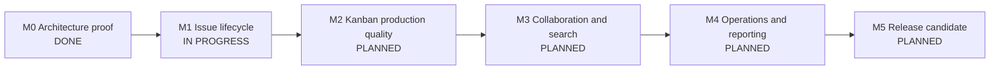

# Vibe JIRA Development Storyboard

Last updated: 2026-10-11  
Plan of record: [`IMPLEMENTATION_PLAN.md`](./IMPLEMENTATION_PLAN.md)  
Current release target: Release 1 — Usable Kanban MVP

This is the living progress view for Vibe JIRA. The implementation plan defines scope and architecture; this storyboard records delivery order, actual status, acceptance evidence, risks, and the next executable work.

## Status rules

| Status        | Meaning                                                                                  |
| ------------- | ---------------------------------------------------------------------------------------- |
| `DONE`        | Acceptance behavior is implemented, tested, documented, and demonstrated.                |
| `PARTIAL`     | Useful behavior exists, but at least one listed acceptance condition is missing.         |
| `NEXT`        | Ready to be the next active vertical slice.                                              |
| `IN PROGRESS` | Implementation is actively underway. Keep work in progress to one primary product story. |
| `PLANNED`     | Ordered in the release backlog but not yet ready or started.                             |
| `BLOCKED`     | Cannot progress without a named decision, dependency, or external change.                |
| `DEFERRED`    | Explicitly outside the current release or first-slice boundary.                          |

A story does not become `DONE` on code completion alone. It must include its schema/domain/API/UI changes as applicable, permission behavior, focused tests, broader quality gates, browser verification, and documentation.

Stories marked `DONE` on 2026-10-11 were accepted against the first-slice scope in plan §20. Their API reference documentation is tracked by `FND-10`; every story completed afterward must meet the full definition above.

## Current snapshot

| Item                 | Current state                                                      |
| -------------------- | ------------------------------------------------------------------ |
| Delivery gate        | First architecture-proving vertical slice complete                 |
| Current milestone    | M1 — Complete the issue lifecycle                                  |
| Active product story | `ISS-02` — Edit an issue                                           |
| Blocking issues      | None                                                               |
| Story roll-up        | 13 done, 10 partial, 1 in progress, 1 next, 30 planned             |
| Release readiness    | Not ready; the first slice is a reliable foundation, not Release 1 |
| Running path         | `docker compose up --build` → `http://localhost:3000`              |

### Verified baseline

| Gate                                                  | Result                     | Evidence                                                                                              |
| ----------------------------------------------------- | -------------------------- | ----------------------------------------------------------------------------------------------------- |
| Formatting, lint, types, unit tests, production build | Passing                    | `npm run check` (skips integration tests when `TEST_DATABASE_URL` is unset)                           |
| Real PostgreSQL transition concurrency                | Passing                    | `docker compose --profile test run --rm test` runs `tests/integration/transition.integration.test.ts` |
| Browser create/move/refresh/history journey           | Passing                    | `tests/e2e/first-slice.spec.ts`                                                                       |
| Serious/critical automated accessibility findings     | Zero in the tested journey | Axe assertion in the browser test                                                                     |
| Dependency vulnerabilities                            | Zero at last audit         | `npm audit` and production-image audit                                                                |
| Container startup and health                          | Passing                    | Healthy application and PostgreSQL; migration and seed exit successfully                              |

## Delivery storyline

| Milestone                      | Outcome                                                                                | Status        | Exit gate                                                                                         |
| ------------------------------ | -------------------------------------------------------------------------------------- | ------------- | ------------------------------------------------------------------------------------------------- |
| M0 — Architecture proof        | A user creates a project and task, moves it, refreshes, and sees durable history       | `DONE`        | First-slice browser, authorization, concurrency, Docker, and accessibility checks pass            |
| M1 — Complete issue lifecycle  | Authorized users create, view, edit, organize, and retire issues with complete history | `IN PROGRESS` | Issue lifecycle works without relying on board drag-and-drop                                      |
| M2 — Kanban production quality | Teams safely manage flow under concurrency and realistic board size                    | `PLANNED`     | Ranking, WIP, invalid rollback, live invalidation, filtering, scale, and multi-user behavior pass |
| M3 — Collaboration and search  | A team can discuss, find, watch, and share work                                        | `PLANNED`     | Comments, mentions, notifications, attachments, search, and saved views pass                      |
| M4 — Operations and reporting  | Admins can operate the installation and leads can trust metrics                        | `PLANNED`     | Administration, audit UI, import/export, jobs, and reports pass                                   |
| M5 — Release candidate         | A recoverable, secure, accessible Release 1 can be launched                            | `PLANNED`     | Every Release 1 acceptance gate and recovery drill passes                                         |

### Schedule view

The plan's estimates are effort ranges, not committed dates. Calendar targets remain unset until team capacity, ownership, and the development start date are confirmed.

| Plan phase                                     | Planning range | Current state | Remaining emphasis                                                                                                |
| ---------------------------------------------- | -------------- | ------------- | ----------------------------------------------------------------------------------------------------------------- |
| Phase 0 — Foundation                           | 1 week         | `PARTIAL`     | CI, OpenAPI, graceful shutdown, migration upgrade checks, dev profile, design tokens, observability, and runbooks |
| Phase 1 — Identity, projects, issues           | 2 weeks        | `PARTIAL`     | M1 issue lifecycle, memberships, roles, teams, hierarchy, remaining fields, and lifecycle administration          |
| Phase 2 — Workflow and Kanban                  | 2 weeks        | `PARTIAL`     | Server-owned ranking/rebalance, swimlanes, configuration, realtime, scale, and multi-user testing                 |
| Phase 3 — Collaboration and finding work       | 2 weeks        | `PLANNED`     | Comments, files, notifications, search, filters, and views                                                        |
| Phase 4 — Administration, reports, portability | 2 weeks        | `PLANNED`     | Administration, jobs, import/export, and validated metrics                                                        |
| Phase 5 — Hardening and launch                 | 1–2 weeks      | `PLANNED`     | Security, accessibility, load, recovery, documentation, and release validation                                    |

## Current milestone: M1 — Complete the issue lifecycle

### Outcome

A project member can create, open, edit, organize, and retire an issue while the server enforces permissions, optimistic concurrency, tenant boundaries, and an immutable activity history.

### Proposed execution order

| Order | Story                                        | Status        | Acceptance summary                                                                                                                                                                   |
| ----- | -------------------------------------------- | ------------- | ------------------------------------------------------------------------------------------------------------------------------------------------------------------------------------ |
| 1     | `ISS-02` Edit an issue                       | `IN PROGRESS` | Edit summary, plain-text description, priority, and assignee (current project members only); stale writes conflict; one field-change event is appended; refresh shows canonical data |
| 2     | `ISS-05` Issue API hardening                 | `NEXT`        | Stable error codes, cursor pagination, idempotent creates, and expanded authorization tests land before more endpoints are added                                                     |
| 3     | `IAM-03` Manage project membership and roles | `PLANNED`     | Project admin adds/removes members and assigns roles; APIs and UI enforce the same capability matrix                                                                                 |
| 4     | `ISS-03` Issue types, labels, and hierarchy  | `PARTIAL`     | Model and UI support the Release 1 hierarchy and reject invalid parent relationships                                                                                                 |
| 5     | `ISS-04` Soft delete and restore             | `PLANNED`     | Authorized deletion hides work without losing history; an administrator can restore it                                                                                               |

Engineering enablers carried alongside the product stories (they do not count against the one-primary-story WIP limit):

| Enabler                       | Why it belongs in M1                                                                                   |
| ----------------------------- | ------------------------------------------------------------------------------------------------------ |
| `FND-06` CI                   | "No merge when checks fail" is unenforceable without it; CI must fail when the integration suite skips |
| `FND-11` Migration discipline | `ISS-02` onward add schema changes; applied migrations must stay immutable and upgrades must be tested |

### M1 non-goals

Comments, attachments, notifications, reporting, custom fields, realtime delivery, workflow administration, and Markdown description rendering (`ISS-07`) remain outside this milestone.

## Story board by epic

### E1 — Foundation

| ID       | Story/outcome                                                     | Status    | Evidence or remaining work                                                                                                                                          |
| -------- | ----------------------------------------------------------------- | --------- | ------------------------------------------------------------------------------------------------------------------------------------------------------------------- |
| `FND-01` | Strict-TypeScript modular monolith and package boundaries         | `DONE`    | `apps/web`, `packages/contracts`, `packages/domain`, and `packages/database`                                                                                        |
| `FND-02` | PostgreSQL schema, explicit checksummed migrations, and seed data | `DONE`    | Migration and seed commands run as one-shot services                                                                                                                |
| `FND-03` | Production Dockerfile and repeatable Compose startup              | `DONE`    | Multi-stage image, persistent PostgreSQL volume, published port, and clean startup path                                                                             |
| `FND-04` | Container runtime safety baseline                                 | `DONE`    | Non-root process, read-only application filesystem, health endpoints, and temporary writable mount                                                                  |
| `FND-05` | Local engineering quality gate                                    | `DONE`    | Formatter, linter, strict types, unit tests, and production build run through `npm run check`                                                                       |
| `FND-06` | CI, image publishing, and vulnerability scanning                  | `PLANNED` | Add repository CI, immutable version/revision tags, dependency scan, and container scan                                                                             |
| `FND-07` | Observability baseline                                            | `PARTIAL` | Correlation IDs, audit IDs, and health endpoints exist; `packages/observability`, structured logs, metrics, traces, and build metadata remain                       |
| `FND-08` | Operator runbooks                                                 | `PLANNED` | Document upgrade, backup, restore, rollback, secret rotation, and image pinning                                                                                     |
| `FND-09` | Graceful shutdown and runtime write paths                         | `PLANNED` | Replace `npm` as PID 1 so `SIGTERM` reaches Node; stop intake and drain transactions; confirm Next.js needs no writes outside `/tmp` under the read-only filesystem |
| `FND-10` | OpenAPI contract and API reference                                | `PLANNED` | Generate OpenAPI from `packages/contracts`, check drift in CI, and document the existing first-slice endpoints                                                      |
| `FND-11` | Migration discipline and upgrade testing                          | `PLANNED` | Applied migrations are immutable; new schema changes ship as new files; CI migrates both a clean database and the previous release schema                           |
| `FND-12` | Development profile and process entrypoints                       | `PLANNED` | Hot-reload Compose profile plus `infra/docker` entrypoints for web, worker, migrate, and seed                                                                       |
| `FND-13` | Design tokens and accessible component baseline                   | `PLANNED` | Extract `packages/ui` tokens and primitives from the current app styles before the UI surface grows                                                                 |

### E2 — Identity and access

| ID       | Story/outcome                                                  | Status    | Evidence or remaining work                                                  |
| -------- | -------------------------------------------------------------- | --------- | --------------------------------------------------------------------------- |
| `IAM-01` | Local email/password sign-in and signed HTTP-only session      | `DONE`    | Suitable for the development slice; production OIDC is still required       |
| `IAM-02` | Organization/project capability enforcement and tenant scoping | `DONE`    | Named server-side capabilities with authorization tests                     |
| `IAM-03` | Project membership and role management                         | `PLANNED` | Add administration API/UI and adversarial role tests                        |
| `IAM-04` | Invitations, activation/deactivation, and production identity  | `PLANNED` | Choose OIDC provider; preserve attribution while blocking deactivated users |
| `IAM-05` | Teams and team-based project membership                        | `PLANNED` | Team model, membership management, and project roles granted through teams  |

### E3 — Projects and issues

| ID       | Story/outcome                                                   | Status        | Evidence or remaining work                                                                                                                            |
| -------- | --------------------------------------------------------------- | ------------- | ----------------------------------------------------------------------------------------------------------------------------------------------------- |
| `PRJ-01` | Create/list a project with stable key and seeded workflow/board | `DONE`        | Project UI, API, transactional defaults, and deep links exist                                                                                         |
| `ISS-01` | Create and view a task with stable key and activity             | `DONE`        | Create dialog, detail drawer, event history, and refresh persistence exist                                                                            |
| `ISS-02` | Edit issue fields with concurrency and history                  | `IN PROGRESS` | Repository update, `PATCH` route, and unit test exist; integration conflict test, browser coverage, and evidence remain. Description stays plain text |
| `ISS-03` | Issue types, priority, assignee, labels, and parent rules       | `PARTIAL`     | Core task/type/priority fields exist; richer type, assignment, label, and hierarchy workflows remain                                                  |
| `ISS-04` | Soft delete and administrative restore                          | `PLANNED`     | Schema seam exists; API, UI, permissions, and restore workflow remain                                                                                 |
| `ISS-05` | Pagination, stable errors, and idempotent vulnerable creates    | `NEXT`        | Apply across existing issue/project endpoints so later stories inherit the contract                                                                   |
| `ISS-06` | Estimate and due-date fields                                    | `PLANNED`     | Schema, validation, create/edit UI, history events, and card/detail display                                                                           |
| `ISS-07` | Sanitized Markdown descriptions                                 | `PLANNED`     | Depends on the description-format decision; sanitized rendering with XSS tests and safe preview                                                       |

### E4 — Workflow engine

| ID       | Story/outcome                                                       | Status    | Evidence or remaining work                                                             |
| -------- | ------------------------------------------------------------------- | --------- | -------------------------------------------------------------------------------------- |
| `WFL-01` | Default five-status workflow and server-owned transition validation | `DONE`    | Directed transitions are validated independently of UI state                           |
| `WFL-02` | Atomic status/rank/version/history/audit/outbox transition          | `DONE`    | Real PostgreSQL concurrent-writer test proves conflict behavior                        |
| `WFL-03` | Safe workflow administration                                        | `PLANNED` | Add configuration UI, active-workflow versioning, and used-status migration safeguards |
| `WFL-04` | Durable outbox processing                                           | `PLANNED` | Add worker loop, retry/idempotency rules, poison-event handling, and monitoring        |

### E5 — Kanban board

| ID       | Story/outcome                                           | Status    | Evidence or remaining work                                                                                                                                                                                                             |
| -------- | ------------------------------------------------------- | --------- | -------------------------------------------------------------------------------------------------------------------------------------------------------------------------------------------------------------------------------------- |
| `BRD-01` | Three-column board read model and durable card movement | `DONE`    | Board API/UI and refresh persistence exist                                                                                                                                                                                             |
| `BRD-02` | Pointer, touch, keyboard, and explicit-button movement  | `PARTIAL` | Pointer, keyboard, button, and optimistic rollback are browser-tested; touch has no mobile-viewport test yet                                                                                                                           |
| `BRD-03` | Version-based concurrent transition protection          | `DONE`    | One writer commits and the stale writer receives a conflict                                                                                                                                                                            |
| `BRD-04` | Full within-column ordering and rank rebalance          | `PARTIAL` | Rank column exists, but the client computes the rank and the server stores it unchecked. Server must derive rank from neighbor issue IDs, keep `numeric` precision end to end (no JS `Number`), and add reorder/rebalance stress tests |
| `BRD-05` | Configurable WIP warning                                | `PARTIAL` | Read model and warning rendering exist; configuration UI and behavior tests remain                                                                                                                                                     |
| `BRD-06` | Realtime invalidation                                   | `PLANNED` | Select SSE or WebSockets, then implement idempotent version-aware refresh                                                                                                                                                              |
| `BRD-07` | Large-board scale and multi-user UX                     | `PLANNED` | Server pagination/filtering, virtualization, load test, and two-browser test remain                                                                                                                                                    |
| `BRD-08` | Swimlanes                                               | `PLANNED` | None, assignee, and epic grouping with URL state and keyboard movement across lanes                                                                                                                                                    |

### E6 — Collaboration

| ID       | Story/outcome                        | Status    | Evidence or remaining work                                                    |
| -------- | ------------------------------------ | --------- | ----------------------------------------------------------------------------- |
| `COL-01` | Comments, mentions, and watchers     | `PLANNED` | Chronological comments with exactly-once mention/watcher events               |
| `COL-02` | Secure attachments                   | `PLANNED` | External object storage, signed access, limits, scan state, and authorization |
| `COL-03` | In-app notifications and preferences | `PLANNED` | Outbox consumer, unread state, preferences, and idempotent delivery           |

### E7 — Search and views

| ID        | Story/outcome                                       | Status    | Evidence or remaining work                                                         |
| --------- | --------------------------------------------------- | --------- | ---------------------------------------------------------------------------------- |
| `SRCH-01` | Board free-text narrowing                           | `PARTIAL` | Client-side summary/key filtering exists; this is not the Release 1 search service |
| `SRCH-02` | Server-side filter model and search                 | `PLANNED` | Tenant-scoped predicates, PostgreSQL search, cursor pagination, and stable sorting |
| `SRCH-03` | Saved filters, quick filters, and backlog/list view | `PLANNED` | Private/project/organization visibility plus shareable URL state                   |

### E8 — Administration and portability

| ID       | Story/outcome                                         | Status    | Evidence or remaining work                                                            |
| -------- | ----------------------------------------------------- | --------- | ------------------------------------------------------------------------------------- |
| `ADM-01` | Correlated audit trail                                | `PARTIAL` | Audit rows are written for implemented mutations; audit query UI and retention remain |
| `ADM-02` | Organization, user, project, and board administration | `PLANNED` | Settings, activation, roles, archiving, templates, and WIP controls                   |
| `ADM-03` | CSV import/export and background jobs                 | `PLANNED` | Dry run, validation report, idempotency, partial-failure policy, status, and download |

### E9 — Reporting

| ID       | Story/outcome                                    | Status    | Evidence or remaining work                                                 |
| -------- | ------------------------------------------------ | --------- | -------------------------------------------------------------------------- |
| `RPT-01` | Published Kanban metric definitions and fixtures | `PLANNED` | Define cycle time, lead time, throughput, aging, and status-time semantics |
| `RPT-02` | Release 1 reports                                | `PLANNED` | CFD, throughput, time distributions, aging WIP, and created/resolved trend |

### E10 — Production readiness

| ID       | Story/outcome                                 | Status    | Evidence or remaining work                                                                                                                                                                                                                                                                                                                                                                           |
| -------- | --------------------------------------------- | --------- | ---------------------------------------------------------------------------------------------------------------------------------------------------------------------------------------------------------------------------------------------------------------------------------------------------------------------------------------------------------------------------------------------------- |
| `PRD-01` | WCAG 2.2 AA accessibility gate                | `PARTIAL` | First journey passes Axe serious/critical scan; manual keyboard/screen-reader and broader page coverage remain                                                                                                                                                                                                                                                                                       |
| `PRD-02` | Responsive and cross-browser support          | `PARTIAL` | Responsive CSS and touch sensor exist; mobile journey and Chrome/Edge/Firefox/Safari matrix remain                                                                                                                                                                                                                                                                                                   |
| `PRD-03` | Security baseline                             | `PARTIAL` | Server authorization, signed cookies, password hashing, same-origin mutation checks, and no known dependency advisories exist; OIDC, rate limits, headers, and threat model remain. Threat model must record: mutations without `Origin`/`Sec-Fetch-Site` are accepted, `x-forwarded-host` is trusted only behind a configured proxy, and `Secure` cookies make plain-HTTP non-localhost access fail |
| `PRD-04` | Performance and load validation               | `PLANNED` | Establish budgets and test board/search/import/realtime paths                                                                                                                                                                                                                                                                                                                                        |
| `PRD-05` | Backup, restore, upgrade, and rollback drills | `PLANNED` | Procedures must be documented and exercised against persisted data                                                                                                                                                                                                                                                                                                                                   |
| `PRD-06` | Release documentation and onboarding          | `PLANNED` | Operator, administrator, member, API, and troubleshooting documentation                                                                                                                                                                                                                                                                                                                              |

## Release 1 acceptance visibility

| Gate                                                                 | Status    | What remains                                                                           |
| -------------------------------------------------------------------- | --------- | -------------------------------------------------------------------------------------- |
| 1. Admin creates project, invites members, assigns roles             | `PARTIAL` | Project creation works; invitation and role administration remain                      |
| 2. Member creates hierarchy and attachments                          | `PARTIAL` | Basic task creation works; hierarchy and attachments remain                            |
| 3. Admin configures workflow, columns, filters, and WIP              | `PARTIAL` | Seeded defaults and WIP rendering exist; configuration surfaces remain                 |
| 4. Concurrent users move and edit without lost updates               | `PARTIAL` | Transition concurrency is proven; edit concurrency and two-browser coverage remain     |
| 5. Invalid/unauthorized transitions have no partial history          | `PARTIAL` | Domain and authorization checks exist; expand transaction-level negative-path coverage |
| 6. Comment, mention, watch, search, filter, notify                   | `PLANNED` | E6 and E7                                                                              |
| 7. Leads view validated Kanban metrics                               | `PLANNED` | E9                                                                                     |
| 8. Admin audits and completes import/export                          | `PARTIAL` | Audit writes exist; audit UI and import/export remain                                  |
| 9. Critical permission, workflow, accessibility, and data automation | `PARTIAL` | First-slice gates pass; expand to full Release 1 matrix                                |
| 10. Backup restoration and rollback are exercised                    | `PLANNED` | `PRD-05`                                                                               |
| 11. Clean Docker host launches a usable browser app                  | `PARTIAL` | App and PostgreSQL launch cleanly; the full stack still lacks S3-compatible storage    |
| 12. Rebuild/upgrade preserves records and attachments                | `PARTIAL` | Database volume persistence works; upgrade drill and attachment persistence remain     |

## Open decisions and dependencies

| Decision                                 | Needed by            | Current direction                                          | Status    |
| ---------------------------------------- | -------------------- | ---------------------------------------------------------- | --------- |
| Hosted, self-hosted, or both             | CI/deployment design | Self-hosted Compose now; keep hosted-ready seams           | `PARTIAL` |
| Production identity provider             | `IAM-04`             | Managed OIDC; local password auth remains development-only | `OPEN`    |
| Realtime transport                       | `BRD-06`             | Prefer SSE unless bidirectional needs emerge               | `OPEN`    |
| Object storage provider                  | `COL-02`             | Cloud-neutral S3-compatible API                            | `OPEN`    |
| Description format                       | `ISS-07`             | Markdown with sanitized rendering; plain text until then   | `OPEN`    |
| Search engine                            | `SRCH-02`            | PostgreSQL native full-text search first                   | `OPEN`    |
| Import compatibility                     | `ADM-03`             | Generic CSV plus documented JIRA CSV mapping               | `OPEN`    |
| Production target and operational budget | `FND-06`, `PRD-04`   | Not selected                                               | `OPEN`    |

No open decision currently blocks `ISS-02`, `ISS-05`, or `IAM-03`. `ISS-02` avoids the description-format decision by storing and rendering plain text (React-escaped).

## Risks to watch

| Risk                                                    | Current signal                                                     | Control                                                                       |
| ------------------------------------------------------- | ------------------------------------------------------------------ | ----------------------------------------------------------------------------- |
| First-slice success is mistaken for Release 1 readiness | Most release features are still planned                            | Keep the acceptance table visible and do not report partial gates as done     |
| Local authentication escapes into production            | Development credentials are convenient                             | Require OIDC before release candidate                                         |
| Outbox accumulates without delivery                     | Writes are durable but no worker consumes them                     | Add monitoring with `WFL-04`; do not promise realtime/notifications before it |
| Ranking degrades under repeated moves                   | Basic destination rank exists                                      | Implement deterministic reorder/rebalance with load/concurrency tests         |
| Tenant leakage appears in new queries                   | Current reads are scoped, future search/report queries are broader | Require adversarial organization/project tests for every new query surface    |
| Operations lag behind feature delivery                  | Backup/rollback and CI are not complete                            | Treat `FND-06`, `FND-08`, and `PRD-05` as release blockers                    |
| Integration tests silently skip                         | `npm run check` passes without `TEST_DATABASE_URL`                 | CI runs the Compose test profile and fails on skipped integration suites      |
| An applied migration is edited                          | `0001_first_slice.sql` may have changed after volumes applied it   | Checksum guard stops startup; ship changes as new migrations (`FND-11`)       |
| Client-supplied ranks corrupt ordering                  | Server stores the rank the client sends                            | Server-derived ranks in `BRD-04`                                              |
| Plan requirements drop out of tracking                  | Several plan items had no story until 2026-10-11                   | When the plan changes, add or update a story ID in the same change            |

## Update protocol

Update this file as part of every story:

1. Before coding, move exactly one primary product story to `IN PROGRESS` and record its observable outcome and acceptance criteria.
2. If a dependency prevents progress, use `BLOCKED` and name the dependency; do not hide it under `IN PROGRESS`.
3. At review, add evidence: migrations, API/UI files, tests, browser result, security/permission behavior, and any ADR.
4. Mark the story `DONE` only after `npm run check`, relevant PostgreSQL integration tests (through the Compose test profile, not skipped), and relevant browser tests pass. Schema changes must be new migration files; never edit an applied one.
5. Update the milestone, Release 1 acceptance table, risk table, and roll-up counts when status changes.
6. Add one changelog entry so progress can be reconstructed without reading Git history.

When a story moves to `IN PROGRESS`, record these fields in its evidence cell or linked work item:

- owner;
- start date and target review date;
- acceptance-test checklist;
- branch or pull request;
- relevant decision and migration links;
- latest quality-gate result;
- named blocker, when applicable.

## Changelog

| Date       | Change                                                                                                                                                                                                 |
| ---------- | ------------------------------------------------------------------------------------------------------------------------------------------------------------------------------------------------------ |
| 2026-10-11 | Created the storyboard and recorded the completed first vertical slice, current gaps, next milestone, release gates, decisions, and risks.                                                             |
| 2026-10-11 | Started `ISS-02`: issue field editing with capability checks, optimistic concurrency, atomic history/audit/outbox writes, and browser coverage.                                                        |
| 2026-10-11 | Closed plan-tracking gaps: added `FND-09`–`FND-13`, `IAM-05`, `ISS-06`, `ISS-07`, and `BRD-08`; moved `ISS-05` to `NEXT`; downgraded `BRD-02` and gate 11 to `PARTIAL`; added decision rows and risks. |
