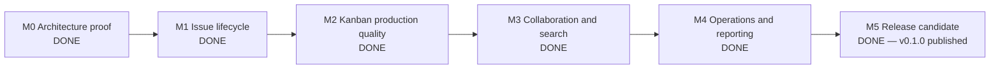

# Vibe JIRA Development Storyboard

Last updated: 2026-10-13
Plan of record: [`IMPLEMENTATION_PLAN.md`](./IMPLEMENTATION_PLAN.md)  
Current release target: Release 1 — Usable Kanban MVP

This is the living progress view for Vibe JIRA. The implementation plan defines scope and architecture; this storyboard records delivery order, actual status, acceptance evidence, risks, and the next executable work.

## Status rules

| Status        | Meaning                                                                                  |
| ------------- | ---------------------------------------------------------------------------------------- |
| `DONE`        | Acceptance behavior is implemented, tested, documented, and demonstrated.                |
| `PARTIAL`     | Useful behavior exists, but at least one listed acceptance condition is missing.         |
| `NEXT`        | Ready to be the next active vertical slice.                                              |
| `IN PROGRESS` | Implementation is actively underway. Keep work in progress to one primary product story. |
| `PLANNED`     | Ordered in the release backlog but not yet ready or started.                             |
| `BLOCKED`     | Cannot progress without a named decision, dependency, or external change.                |
| `DEFERRED`    | Explicitly outside the current release or first-slice boundary.                          |

A story does not become `DONE` on code completion alone. It must include its schema/domain/API/UI changes as applicable, permission behavior, focused tests, broader quality gates, browser verification, and documentation.

Stories marked `DONE` on 2026-10-11 were accepted against the first-slice scope in plan §20. Their API reference documentation is tracked by `FND-10`; every story completed afterward must meet the full definition above.

## Current snapshot

| Item                 | Current state                                                                                                                     |
| -------------------- | --------------------------------------------------------------------------------------------------------------------------------- |
| Delivery gate        | M2–M5 complete; Release 1 candidate `v0.1.0` is published after all automated and human gates passed                              |
| Current milestone    | M5 — Release candidate (`DONE`)                                                                                                   |
| Active product story | None                                                                                                                              |
| Blocking issues      | None                                                                                                                              |
| Story roll-up        | 55 done, 0 partial, 0 in progress, 0 planned                                                                                      |
| Release readiness    | Release candidate approved; live production activation remains gated by the environment-specific unchecked deployment items       |
| Release artifact     | `ghcr.io/tj-engineer/vibe-jira@sha256:90a72b2133389f5e5927ccf93f87ac393946909c21bb24548c465c75dad9dc55`                           |
| Running path         | `docker compose up --build -d` → `http://localhost:3000`; `docker compose -f compose.yaml -f compose.dev.yaml up` for development |

### Verified baseline

| Gate                                                                | Result                   | Evidence                                                                                                                    |
| ------------------------------------------------------------------- | ------------------------ | --------------------------------------------------------------------------------------------------------------------------- |
| Formatting, lint, types, unit tests, OpenAPI, production build      | Passing                  | `npm run check`; 50 unit tests pass                                                                                         |
| Real PostgreSQL lifecycle, hierarchy, identity, teams, and recovery | Passing                  | 23 PostgreSQL integration tests pass against the current schema                                                             |
| Cross-browser Release 1 journeys                                    | Passing                  | 70 pass across Chromium, Firefox, and WebKit; two raw-touch cases intentionally skip outside Chromium                       |
| Serious/critical automated accessibility findings                   | Zero across tested pages | Axe plus focused keyboard/reflow/preference gates cover board, dialogs, search, backlog, administration, reports, and teams |
| Performance budgets                                                 | Passing                  | Local p95: board 30.7 ms, search 52.3 ms, CSV dry run 17.5 ms, realtime connect 18.1 ms                                     |
| Recovery and attachment integrity                                   | Passing                  | Quiescent PostgreSQL/object restore verifies counts and exact bytes for every active clean attachment                       |
| Dependency vulnerabilities                                          | Zero at last audit       | `npm audit`; CI also scans the release container with Trivy                                                                 |
| Container startup and health                                        | Passing                  | A clean isolated Compose stack launched app, PostgreSQL, private S3 storage, ClamAV, and both workers                       |

## Delivery storyline

| Milestone                      | Outcome                                                                                | Status | Exit gate                                                                                           |
| ------------------------------ | -------------------------------------------------------------------------------------- | ------ | --------------------------------------------------------------------------------------------------- |
| M0 — Architecture proof        | A user creates a project and task, moves it, refreshes, and sees durable history       | `DONE` | First-slice browser, authorization, concurrency, Docker, and accessibility checks pass              |
| M1 — Complete issue lifecycle  | Authorized users create, view, edit, organize, and retire issues with complete history | `DONE` | Issue lifecycle works without relying on board drag-and-drop                                        |
| M2 — Kanban production quality | Teams safely manage flow under concurrency and realistic board size                    | `DONE` | Ranking, WIP, invalid rollback, live invalidation, filtering, scale, and multi-user behavior pass   |
| M3 — Collaboration and search  | A team can discuss, find, watch, and share work                                        | `DONE` | Comments, mentions, notifications, attachments, search, and saved views pass                        |
| M4 — Operations and reporting  | Admins can operate the installation and leads can trust metrics                        | `DONE` | Administration, audit UI, import/export, jobs, and reports pass                                     |
| M5 — Release candidate         | A recoverable, secure, accessible Release 1 can be launched                            | `DONE` | `v0.1.0` and its immutable digest were published after quality, migration, browser, and Trivy gates |

### Schedule view

The plan's estimates are effort ranges, not committed dates. Calendar targets remain unset until team capacity, ownership, and the development start date are confirmed.

| Plan phase                                     | Planning range | Current state | Remaining emphasis                                                                                        |
| ---------------------------------------------- | -------------- | ------------- | --------------------------------------------------------------------------------------------------------- |
| Phase 0 — Foundation                           | 1 week         | `DONE`        | CI, OpenAPI drift, migration upgrade, dev profile, observability, shutdown, runbooks, and UI tokens pass  |
| Phase 1 — Identity, projects, issues           | 2 weeks        | `DONE`        | Invitations/OIDC, direct and team roles, hierarchy, lifecycle, schedule fields, and Markdown are complete |
| Phase 2 — Workflow and Kanban                  | 2 weeks        | `DONE`        | Server-owned ranking/rebalance, swimlanes, configuration, realtime, scale, and multi-user testing         |
| Phase 3 — Collaboration and finding work       | 2 weeks        | `DONE`        | Comments, files, notifications, search, filters, and views                                                |
| Phase 4 — Administration, reports, portability | 2 weeks        | `DONE`        | Administration, durable jobs, import/export, audit, outbox operations, and validated reports pass         |
| Phase 5 — Hardening and launch                 | 1–2 weeks      | `DONE`        | Release candidate approved and published; production activation is tracked separately in the checklist    |

## Completed milestone: M1 — Complete the issue lifecycle

### Outcome

A project member can create, open, edit, organize, and retire an issue while the server enforces permissions, optimistic concurrency, tenant boundaries, and an immutable activity history.

### Proposed execution order

| Order | Story                                        | Status | Acceptance summary                                                                                                                                                        |
| ----- | -------------------------------------------- | ------ | ------------------------------------------------------------------------------------------------------------------------------------------------------------------------- |
| 1     | `ISS-02` Edit an issue                       | `DONE` | Summary, plain-text description, priority, and active admin/member assignee edits are versioned; one atomic field-change event is appended; refresh shows canonical data  |
| 2     | `ISS-05` Issue API hardening                 | `DONE` | Stable errors, scoped cursor pagination, atomic idempotent project/issue creates, and adversarial authorization tests pass                                                |
| 3     | `IAM-03` Manage project membership and roles | `DONE` | Project admins add/change/remove existing organization users; audited writes, invariants, role-aware UI, PostgreSQL, browser, and Axe tests pass                          |
| 4     | `ISS-03` Issue types, labels, and hierarchy  | `DONE` | Five selectable types, assignee-on-create, normalized labels, and validated Epic → standard → Subtask relationships pass API, PostgreSQL, browser, refresh, and Axe tests |
| 5     | `ISS-04` Soft delete and restore             | `DONE` | Members/admins soft-delete versioned issues; active children prevent deletion; project admins list and restore deleted work; history/audit/outbox and authorization pass  |

Engineering enablers carried alongside the product stories (they do not count against the one-primary-story WIP limit):

| Enabler                       | Why it belongs in M1                                                                                   |
| ----------------------------- | ------------------------------------------------------------------------------------------------------ |
| `FND-06` CI                   | "No merge when checks fail" is unenforceable without it; CI must fail when the integration suite skips |
| `FND-11` Migration discipline | `ISS-02` onward add schema changes; applied migrations must stay immutable and upgrades must be tested |

### M1 non-goals

Comments, attachments, notifications, reporting, custom fields, realtime delivery, workflow administration, and Markdown description rendering (`ISS-07`) remain outside this milestone.

## Completed milestone: M5 — Release candidate

M4 closed with generalized outbox delivery, safe workflow administration, correlated audit inspection, organization administration, durable CSV jobs, and event-derived reports. M5 closes with identity, teams, issue scheduling, safe Markdown, security, observability, CI, OpenAPI, load budgets, recovery, cross-browser validation, release documentation, and dated human accessibility evidence in place. The tagged `v0.1.0` workflow passed quality, dependency audit, prior/current migrations, 23 PostgreSQL integration tests, the 70-case browser matrix, and a zero-high/critical Trivy scan before publishing the immutable GHCR digest. Production activation is a separate operational approval and remains blocked from traffic until the unchecked items in `docs/release-checklist.md` are satisfied.

## Story board by epic

### E1 — Foundation

| ID       | Story/outcome                                                     | Status | Evidence or remaining work                                                                                                                                  |
| -------- | ----------------------------------------------------------------- | ------ | ----------------------------------------------------------------------------------------------------------------------------------------------------------- |
| `FND-01` | Strict-TypeScript modular monolith and package boundaries         | `DONE` | `apps/web`, `packages/contracts`, `packages/domain`, and `packages/database`                                                                                |
| `FND-02` | PostgreSQL schema, explicit checksummed migrations, and seed data | `DONE` | Migration and seed commands run as one-shot services                                                                                                        |
| `FND-03` | Production Dockerfile and repeatable Compose startup              | `DONE` | Multi-stage image, persistent PostgreSQL volume, published port, and clean startup path                                                                     |
| `FND-04` | Container runtime safety baseline                                 | `DONE` | Non-root process, read-only application filesystem, health endpoints, and temporary writable mount                                                          |
| `FND-05` | Local engineering quality gate                                    | `DONE` | Formatter, linter, strict types, unit tests, and production build run through `npm run check`                                                               |
| `FND-06` | CI, image publishing, and vulnerability scanning                  | `DONE` | CI runs quality, dependency audit, prior/current PostgreSQL migrations, integration tests, three-browser Playwright, Trivy, and semver/SHA GHCR publishing  |
| `FND-07` | Observability baseline                                            | `DONE` | Structured logs, W3C trace propagation, correlation IDs, audit linkage, readiness/liveness/metrics endpoints, and build version/revision metadata pass      |
| `FND-08` | Operator runbooks                                                 | `DONE` | Deployment, upgrade, quiescent backup/restore, rollback, secret rotation, image pinning, audit, outbox, and data-job procedures are documented              |
| `FND-09` | Graceful shutdown and runtime write paths                         | `DONE` | Direct Node entrypoint receives `SIGTERM`; workers exit cleanly; app stops promptly; the non-root read-only runtime writes only to `/tmp`                   |
| `FND-10` | OpenAPI contract and API reference                                | `DONE` | Zod-backed schemas generate `docs/openapi.json`; request bodies and multipart files are represented; CI rejects drift; `docs/api.md` documents use          |
| `FND-11` | Migration discipline and upgrade testing                          | `DONE` | Checksums preserve applied migrations; schema additions use `0018`–`0022`; CI migrates the prior boundary and then the current schema plus a clean database |
| `FND-12` | Development profile and process entrypoints                       | `DONE` | `compose.dev.yaml` provides hot reload; one entrypoint supports web, worker, migrate, seed, and health commands                                             |
| `FND-13` | Design tokens and accessible component baseline                   | `DONE` | `packages/ui` owns shared tokens; semantic HTML, labeled controls, focus behavior, live status, responsive styles, and Axe gates form the baseline          |

### E2 — Identity and access

| ID       | Story/outcome                                                  | Status | Evidence or remaining work                                                                                                                                                                                                                     |
| -------- | -------------------------------------------------------------- | ------ | ---------------------------------------------------------------------------------------------------------------------------------------------------------------------------------------------------------------------------------------------- |
| `IAM-01` | Local email/password sign-in and signed HTTP-only session      | `DONE` | Development sign-in remains available behind an explicit deployment flag; signed sessions use origin-aware secure, HTTP-only, SameSite cookies                                                                                                 |
| `IAM-02` | Organization/project capability enforcement and tenant scoping | `DONE` | Named server-side capabilities with authorization tests                                                                                                                                                                                        |
| `IAM-03` | Project membership and role management                         | `DONE` | Existing organization users can be added, re-roled, and removed through project settings; mutations are tenant-scoped, audited, transactional, and enforce last-admin/active-assignment invariants; member/viewer API and UI restrictions pass |
| `IAM-04` | Invitations, activation/deactivation, and production identity  | `DONE` | Migration `0020`; one-time invitations, activation/deactivation with attribution preservation, provider-neutral OIDC authorization code + PKCE, strict token validation, rate limits, and browser/integration coverage pass                    |
| `IAM-05` | Teams and team-based project membership                        | `DONE` | Migration `0022`; organization-admin team/member management, project-admin team role grants, strongest effective role resolution, audit/outbox, revoke behavior, PostgreSQL, and browser coverage pass                                         |

### E3 — Projects and issues

| ID       | Story/outcome                                                   | Status | Evidence or remaining work                                                                                                                                                                                                                               |
| -------- | --------------------------------------------------------------- | ------ | -------------------------------------------------------------------------------------------------------------------------------------------------------------------------------------------------------------------------------------------------------- |
| `PRJ-01` | Create/list a project with stable key and seeded workflow/board | `DONE` | Project UI, API, transactional defaults, and deep links exist                                                                                                                                                                                            |
| `ISS-01` | Create and view a task with stable key and activity             | `DONE` | Create dialog, detail drawer, event history, and refresh persistence exist                                                                                                                                                                               |
| `ISS-02` | Edit issue fields with concurrency and history                  | `DONE` | `PATCH` contract/UI, `issue:edit`, version conflict, active assignable-user validation, atomic history/audit/outbox, no-op behavior, PostgreSQL integration, browser refresh, and edit-form Axe coverage pass; `ISS-07` adds safe Markdown rendering     |
| `ISS-03` | Issue types, priority, assignee, labels, and parent rules       | `DONE` | Migration `0003`; shared contracts/domain rules; atomic create/edit persistence; type, assignee, label, and parent UI; canonical board/detail reads; same-project and child-compatibility guards; unit, five PostgreSQL, and three browser journeys pass |
| `ISS-04` | Soft delete and administrative restore                          | `DONE` | Migration `0004`; versioned member/admin soft delete; admin-only inventory/restore; active-child, parent-hierarchy, assignee, stale-write, tenant, member, and viewer guards; atomic events/audit/outbox; six PostgreSQL and four browser journeys pass  |
| `ISS-05` | Pagination, stable errors, and idempotent vulnerable creates    | `DONE` | Migration `0002`; paginated project/issue collection APIs; load-more project UI; stable validation/conflict/cursor/idempotency errors; transactional retry replay; tenant/viewer/concurrency tests; production build and browser journey pass            |
| `ISS-06` | Estimate and due-date fields                                    | `DONE` | Migration `0021`; bounded estimates and dates flow through contracts, create/edit, cards/details, CSV/search, immutable field-change history, PostgreSQL, and browser persistence coverage                                                               |
| `ISS-07` | Sanitized Markdown descriptions                                 | `DONE` | Shared allowlist renderer supports safe Markdown while stripping raw HTML and unsafe URLs; description UI, unit XSS cases, and three-browser assertions pass                                                                                             |

### E4 — Workflow engine

| ID       | Story/outcome                                                       | Status | Evidence or remaining work                                                                                                                                                                                                                                                                                         |
| -------- | ------------------------------------------------------------------- | ------ | ------------------------------------------------------------------------------------------------------------------------------------------------------------------------------------------------------------------------------------------------------------------------------------------------------------------ |
| `WFL-01` | Default five-status workflow and server-owned transition validation | `DONE` | Directed transitions are validated independently of UI state                                                                                                                                                                                                                                                       |
| `WFL-02` | Atomic status/rank/version/history/audit/outbox transition          | `DONE` | Real PostgreSQL concurrent-writer test proves conflict behavior                                                                                                                                                                                                                                                    |
| `WFL-03` | Safe workflow administration                                        | `DONE` | Versioned project-admin status, category, color, ordering, directed-transition, and column-mapping configuration; explicit used-status migration with issue history; stale/tenant/role/invalid-graph rejection; atomic audit/outbox writes; 39 unit, 17 PostgreSQL, 16 browser, Axe, build, and Compose gates pass |
| `WFL-04` | Durable outbox processing                                           | `DONE` | Migration `0014`; generalized `SKIP LOCKED` worker; idempotent delivery ledger; bounded exponential retry and dead letters; heartbeat-backed container health; organization-admin monitoring/retry UI; structured logs and operator guide; 38 unit, 16 PostgreSQL, 15 browser, Axe, build, and Compose gates pass  |

### E5 — Kanban board

| ID       | Story/outcome                                           | Status | Evidence or remaining work                                                                                                                                                                                                                                                                                                                                                                                  |
| -------- | ------------------------------------------------------- | ------ | ----------------------------------------------------------------------------------------------------------------------------------------------------------------------------------------------------------------------------------------------------------------------------------------------------------------------------------------------------------------------------------------------------------- |
| `BRD-01` | Three-column board read model and durable card movement | `DONE` | Board API/UI and refresh persistence exist                                                                                                                                                                                                                                                                                                                                                                  |
| `BRD-02` | Pointer, touch, keyboard, and explicit-button movement  | `DONE` | Mouse and real touch-event drag journeys; mobile viewport/dialog behavior; workflow-aware adjacent-column controls; explicit same-column status transitions; keyboard ordering; server-rejected canonical refresh; invalid-workflow notice; refresh persistence; all eight browser journeys and `npm run check` pass                                                                                        |
| `BRD-03` | Version-based concurrent transition protection          | `DONE` | One writer commits and the stale writer receives a conflict                                                                                                                                                                                                                                                                                                                                                 |
| `BRD-04` | Full within-column ordering and rank rebalance          | `DONE` | Migration `0005`; strict neighbor-only move contract; project-scoped transaction lock; workflow, column, adjacency, and version validation; exact decimal-string ranks; automatic rebalance; `REORDERED` history/audit/outbox; sortable cards plus keyboard controls; 50-card exhaustion stress, seven PostgreSQL tests, `npm run check`, five browser journeys, refresh persistence, and Axe coverage pass |
| `BRD-05` | Configurable WIP warning                                | `DONE` | Migration `0006`; admin-only board settings API/UI; positive-or-disabled validation; optimistic concurrency; scoped audit/outbox writes; filter-independent, non-blocking warnings; member/viewer denials; six unit, eight PostgreSQL, and six browser tests; persistence, Axe, `npm run check`, and documentation pass                                                                                     |
| `BRD-06` | Realtime invalidation                                   | `DONE` | Migration `0007`; ADR `0002`; PostgreSQL commit triggers and shared reconnecting listener; authenticated project-scoped SSE with heartbeat/sync; canonical coalesced refresh; duplicate/stale version suppression; two unit, nine PostgreSQL, and nine browser tests including two-session create/move propagation; full gates and docs pass                                                                |
| `BRD-07` | Large-board scale and multi-user UX                     | `DONE` | Migration `0008`; scoped PostgreSQL search/type/priority/assignee/label/epic filters; filter-bound cursor pages; 50-card pages and 100-card DOM window; exact global movement neighbors and complete WIP counts; URL persistence; filter-independent epic metadata; 1,000-issue traversal and <500 ms p95 budget; two-session scale journey; 29 unit, 10 PostgreSQL, 11 browser, Axe, build, and docs pass  |
| `BRD-08` | Swimlanes                                               | `DONE` | None/assignee/root-epic projections; recursive Subtask epic resolution; stable active-assignee, Unassigned, No epic, and filtered-empty lanes; shareable URL state; unique accessible headings/drop targets; global-rank-safe keyboard reorder and movement; grouped realtime; mobile/Axe; two unit and ten browser journeys plus full gates pass                                                           |

### E6 — Collaboration

| ID       | Story/outcome                        | Status | Evidence or remaining work                                                                                                                                                                                                                                                                                                                                                              |
| -------- | ------------------------------------ | ------ | --------------------------------------------------------------------------------------------------------------------------------------------------------------------------------------------------------------------------------------------------------------------------------------------------------------------------------------------------------------------------------------- |
| `COL-01` | Comments, mentions, and watchers     | `DONE` | Migration `0009`; chronological sanitized plain-text comments; deterministic active-project `@email` mentions; explicit watch/mute durable against automatic participant watching; scoped capability checks; idempotent atomic history/audit/outbox and exactly-once delivery intents; drawer UI and two-session refresh; 30 unit, 11 PostgreSQL, 12 browser, Axe, build, and docs pass |
| `COL-02` | Secure attachments                   | `DONE` | Migration `0011`; private S3-compatible SeaweedFS storage; five-minute signed downloads; strict 10 MiB/type/content limits and 20-file issue cap; ClamAV clean/rejected/error states; uploader/admin soft removal; scoped events/audit/outbox; 34 unit, 13 PostgreSQL, 12 browser, Axe, build, and full-stack container gates pass                                                      |
| `COL-03` | In-app notifications and preferences | `DONE` | Migration `0010`; exactly-once notification inbox; `SKIP LOCKED` worker and bounded read-side drain; event preferences; unread/read-all state; tenant-scoped cursor APIs; exponential retry and poison dead-letter; accessible responsive UI and issue links; 31 unit, 12 PostgreSQL, 12 browser, Axe, build, container, and docs pass                                                  |

### E7 — Search and views

| ID        | Story/outcome                                       | Status | Evidence or remaining work                                                                                                                                                                                                                                                                                                               |
| --------- | --------------------------------------------------- | ------ | ---------------------------------------------------------------------------------------------------------------------------------------------------------------------------------------------------------------------------------------------------------------------------------------------------------------------------------------- |
| `SRCH-01` | Board free-text narrowing                           | `DONE` | Server-side key/summary/description matching, bounded results, URL persistence, filter-independent WIP, PostgreSQL scale coverage, and browser refresh proof pass                                                                                                                                                                        |
| `SRCH-02` | Server-side filter model and search                 | `DONE` | Migration `0012`; weighted PostgreSQL full-text/key search; authorization-first cross-project scope; project/type/status/category/priority/assignee/reporter/label/parent/created/updated predicates; six stable sorts and filter-bound cursors; responsive URL-driven UI; 35 unit, 14 PostgreSQL, 13 browser, Axe, build, and docs pass |
| `SRCH-03` | Saved filters, quick filters, and backlog/list view | `DONE` | Migration `0013`; private/project/organization visibility; versioned audited CRUD; stable filter links; compatible project quick filters; cursor-paged backlog/all-issues views; capability and tenant enforcement; 37 unit, 15 PostgreSQL, 14 browser, Axe, build, and docs gates pass                                                  |

### E8 — Administration and portability

| ID       | Story/outcome                                         | Status | Evidence or remaining work                                                                                                                                                                                                                                                                                        |
| -------- | ----------------------------------------------------- | ------ | ----------------------------------------------------------------------------------------------------------------------------------------------------------------------------------------------------------------------------------------------------------------------------------------------------------------- |
| `ADM-01` | Correlated audit trail                                | `DONE` | Migration `0015`; organization-admin cursor API/UI with actor/action/target/correlation/date filters; versioned 30–3,650-day policy; hourly pruning; atomic audit/outbox update evidence; authorization, 40 unit, 18 PostgreSQL, 17 browser, Axe, build, Compose, and operations-guide gates pass                 |
| `ADM-02` | Organization, user, project, and board administration | `DONE` | Migration `0016`; versioned organization naming, user activation/roles with last-admin and assignment safeguards, project/board renaming and archive/restore, five-status/simple templates, WIP settings integration, atomic audit/outbox, 42 unit, 19 PostgreSQL, 18 browser, Axe, build, and Compose gates pass |
| `ADM-03` | CSV import/export and background jobs                 | `DONE` | Migration `0017`; quoted UTF-8 CSV dry-run and bounded validation; atomic-reject/skip-invalid policy; idempotent `SKIP LOCKED` background import/export; durable status/results; protected download; audit/outbox; operator guide; 45 unit, 20 PostgreSQL, 19 browser, Axe, build, and Compose gates pass         |

### E9 — Reporting

| ID       | Story/outcome                                    | Status | Evidence or remaining work                                                                                                                                                                                       |
| -------- | ------------------------------------------------ | ------ | ---------------------------------------------------------------------------------------------------------------------------------------------------------------------------------------------------------------- |
| `RPT-01` | Published Kanban metric definitions and fixtures | `DONE` | Event-derived UTC lead/cycle/throughput/aging/status-category definitions, historical boundaries, reopened-work behavior, deterministic unit fixtures, PostgreSQL fixtures, and operator-facing definitions pass |
| `RPT-02` | Release 1 reports                                | `DONE` | Date-bounded throughput, cumulative flow, created/resolved, average category time, lead/cycle summaries, and aging WIP UI/API pass authorization, PostgreSQL, browser, keyboard, Axe, build, and Compose gates   |

### E10 — Production readiness

| ID       | Story/outcome                                 | Status | Evidence or remaining work                                                                                                                                                                             |
| -------- | --------------------------------------------- | ------ | ------------------------------------------------------------------------------------------------------------------------------------------------------------------------------------------------------ |
| `PRD-01` | WCAG 2.2 AA accessibility gate                | `DONE` | 70 cross-browser cases plus signed VoiceOver 10/Safari 26.6.2 and visual-state scenarios cover focus, reflow, text spacing, target size, preferences, semantics, announcements, and Axe                |
| `PRD-02` | Responsive and cross-browser support          | `DONE` | Matrix passes 70 cases across Chromium, Firefox, and WebKit; mobile pointer/touch is exercised in Chromium and responsive layouts are Axe-covered                                                      |
| `PRD-03` | Security baseline                             | `DONE` | CSP/security headers, same-origin writes, secure-origin-aware cookies, PostgreSQL rate limits, hardened OIDC/invitations, private scanned attachments, trace correlation, threat model, and tests pass |
| `PRD-04` | Performance and load validation               | `DONE` | Published budgets cover board/search/CSV/realtime; local p95 values 30.7/52.3/17.5/18.1 ms pass, plus the 1,000-issue PostgreSQL board fixture                                                         |
| `PRD-05` | Backup, restore, upgrade, and rollback drills | `DONE` | Quiescent database/object backup and isolated restore drill pass with project/issue/attachment counts and exact-byte checks for all active clean attachment objects                                    |
| `PRD-06` | Release documentation and onboarding          | `DONE` | Deployment, admin, member, API, accessibility, performance, security, troubleshooting, operations, and release-checklist documentation is present                                                      |

## Release 1 acceptance visibility

| Gate                                                                 | Status | What remains                                                                                                          |
| -------------------------------------------------------------------- | ------ | --------------------------------------------------------------------------------------------------------------------- |
| 1. Admin creates project, invites members, assigns roles             | `DONE` | One-time invitations, activation/deactivation, direct roles, teams, effective roles, and project creation pass        |
| 2. Member creates hierarchy and attachments                          | `DONE` | Hierarchy plus bounded, scanned, private-object attachments pass API and browser acceptance                           |
| 3. Admin configures workflow, columns, filters, and WIP              | `DONE` | Versioned workflow/status/transition mapping, saved quick filters, and WIP settings pass                              |
| 4. Concurrent users move and edit without lost updates               | `DONE` | Version conflicts, exact ordering, and two-session committed create/move propagation pass                             |
| 5. Invalid/unauthorized transitions have no partial history          | `DONE` | Stale, unauthorized, cross-project, invalid-graph, and used-status failures roll back atomically                      |
| 6. Comment, mention, watch, search, filter, notify                   | `DONE` | Collaboration, notifications, complete search, saved/quick filters, and backlog views pass                            |
| 7. Leads view validated Kanban metrics                               | `DONE` | Event-derived definitions, deterministic fixtures, report API/UI, and authorization pass                              |
| 8. Admin audits and completes import/export                          | `DONE` | Correlated audit UI plus durable dry-run/import/export jobs and protected downloads pass                              |
| 9. Critical permission, workflow, accessibility, and data automation | `DONE` | 50 unit, 23 PostgreSQL integration, and 70 cross-browser cases pass; Axe has zero serious/critical findings           |
| 10. Backup restoration and rollback are exercised                    | `DONE` | Quiescent backup and isolated recovery drill verify relational counts and every clean attachment byte stream          |
| 11. Clean Docker host launches a usable browser app                  | `DONE` | Compose launches the app, PostgreSQL, private S3 storage, ClamAV, migrations, seed, and worker                        |
| 12. Rebuild/upgrade preserves records and attachments                | `DONE` | Prior/current migration path, rebuild persistence, quiescent object backup, and exact-byte recovery verification pass |

## Open decisions and dependencies

| Decision                                 | Needed by            | Current direction                                                           | Status    |
| ---------------------------------------- | -------------------- | --------------------------------------------------------------------------- | --------- |
| Hosted, self-hosted, or both             | CI/deployment design | Self-hosted Compose Release 1 with hosted-ready REST/OIDC/S3 seams          | `DECIDED` |
| Production identity provider             | `IAM-04`             | Standards-based configurable OIDC; provider selection is deployment-owned   | `DECIDED` |
| Realtime transport                       | `BRD-06`             | SSE; board updates are server-to-client invalidations only                  | `DECIDED` |
| Object storage provider                  | `COL-02`             | S3-compatible adapter; SeaweedFS is the local Compose implementation        | `DECIDED` |
| Description format                       | `ISS-07`             | Sanitized Markdown with an explicit allowlist and raw-HTML rejection        | `DECIDED` |
| Search engine                            | `SRCH-02`            | Weighted PostgreSQL `tsvector` search with GIN indexing                     | `DECIDED` |
| Import compatibility                     | `ADM-03`             | Published generic CSV contract; vendor exports are normalized before import | `DECIDED` |
| Production target and operational budget | `FND-06`, `PRD-04`   | Not selected                                                                | `OPEN`    |

No open decision blocks the implemented M2–M5 scope. The production target and operational budget remain environment-specific release approvals rather than code dependencies.

## Risks to watch

| Risk                                                         | Current signal                                                      | Control                                                                                                   |
| ------------------------------------------------------------ | ------------------------------------------------------------------- | --------------------------------------------------------------------------------------------------------- |
| Engineering readiness is mistaken for final release approval | The M5 candidate is published, but no production target is approved | Keep production activation separate and require every unchecked deployment item before routing traffic    |
| Local authentication escapes into production                 | Development credentials remain convenient                           | Production defaults to OIDC when configured; allow password auth only through an explicit deployment flag |
| Outbox delivery regresses or poison events accumulate        | General and notification topics have separate healthy workers       | Monitor queue age/dead letters in the admin UI and retain retry/idempotency integration tests             |
| Ranking degrades under repeated moves                        | A 50-card repeated-midpoint test forces and passes exact rebalance  | Retain the exhaustion stress case and monitor latency/rebalance behavior in deployment metrics            |
| Tenant leakage appears in new queries                        | Search, reports, teams, and administration broaden query surfaces   | Retain adversarial organization/project tests for every query and effective-role change                   |
| Recovery artifacts are inconsistent                          | A live object archive once restored metadata without readable bytes | Keep services quiescent during backup and require exact-byte verification in every drill                  |
| Integration tests silently skip                              | `npm run check` passes without `TEST_DATABASE_URL`                  | CI runs the Compose test profile and fails on skipped integration suites                                  |
| An applied migration is edited                               | Current schema now spans 22 immutable files                         | Checksum guard stops startup; ship changes only as new migrations (`FND-11`)                              |
| Client-supplied ranks corrupt ordering                       | Strict contracts reject ranks and accept scoped adjacent IDs only   | Keep rank derivation and rebalance server-owned                                                           |
| Plan requirements drop out of tracking                       | Several plan items had no story until 2026-10-11                    | When the plan changes, add or update a story ID in the same change                                        |

## Update protocol

Update this file as part of every story:

1. Before coding, move exactly one primary product story to `IN PROGRESS` and record its observable outcome and acceptance criteria.
2. If a dependency prevents progress, use `BLOCKED` and name the dependency; do not hide it under `IN PROGRESS`.
3. At review, add evidence: migrations, API/UI files, tests, browser result, security/permission behavior, and any ADR.
4. Mark the story `DONE` only after `npm run check`, relevant PostgreSQL integration tests (through the Compose test profile, not skipped), and relevant browser tests pass. Schema changes must be new migration files; never edit an applied one.
5. Update the milestone, Release 1 acceptance table, risk table, and roll-up counts when status changes.
6. Add one changelog entry so progress can be reconstructed without reading Git history.

When a story moves to `IN PROGRESS`, record these fields in its evidence cell or linked work item:

- owner;
- start date and target review date;
- acceptance-test checklist;
- branch or pull request;
- relevant decision and migration links;
- latest quality-gate result;
- named blocker, when applicable.

## Changelog

| Date       | Change                                                                                                                                                                                                                                                                                                                                                                         |
| ---------- | ------------------------------------------------------------------------------------------------------------------------------------------------------------------------------------------------------------------------------------------------------------------------------------------------------------------------------------------------------------------------------ |
| 2026-10-11 | Created the storyboard and recorded the completed first vertical slice, current gaps, next milestone, release gates, decisions, and risks.                                                                                                                                                                                                                                     |
| 2026-10-11 | Started `ISS-02`: issue field editing with capability checks, optimistic concurrency, atomic history/audit/outbox writes, and browser coverage.                                                                                                                                                                                                                                |
| 2026-10-11 | Closed plan-tracking gaps: added `FND-09`–`FND-13`, `IAM-05`, `ISS-06`, `ISS-07`, and `BRD-08`; moved `ISS-05` to `NEXT`; downgraded `BRD-02` and gate 11 to `PARTIAL`; added decision rows and risks.                                                                                                                                                                         |
| 2026-10-11 | Completed `ISS-02`: editable summary/description/priority/assignee, `issue:edit` enforcement, stale-write and viewer-assignee rejection, atomic history/audit/outbox, refresh persistence, and accessibility coverage all pass.                                                                                                                                                |
| 2026-10-11 | Started `ISS-05`: stable API errors, cursor pagination, idempotent project/issue creates, and adversarial authorization coverage.                                                                                                                                                                                                                                              |
| 2026-10-11 | Completed `ISS-05`: cursor-paginated project/issue collections, stable API errors, atomic idempotent creates, tenant and viewer adversarial coverage, PostgreSQL integration, production build, and browser acceptance all pass; moved `IAM-03` to `NEXT`.                                                                                                                     |
| 2026-10-11 | Started `IAM-03`: audited project member add/change/remove flows for existing organization users, invariant enforcement, role-aware board UI, and API/browser authorization coverage.                                                                                                                                                                                          |
| 2026-10-11 | Completed `IAM-03`: project member settings, audited transactional role changes, last-admin and assignment safeguards, tenant isolation, member/viewer API denials, role-aware board controls, PostgreSQL integration, two browser journeys, and Axe coverage pass; moved `ISS-03` to `NEXT`.                                                                                  |
| 2026-10-11 | Started `ISS-03`: selectable issue types, labels, assignee-on-create, and validated Epic → standard issue → Subtask hierarchy across persistence, API, UI, and tests.                                                                                                                                                                                                          |
| 2026-10-11 | Completed `ISS-03`: migration `0003`, shared hierarchy rules, type/assignee/label/parent create-edit-detail UI, tenant/project-scoped validation, atomic history/audit/outbox writes, five PostgreSQL tests, three browser journeys, refresh persistence, and Axe coverage pass; moved `ISS-04` to `NEXT`.                                                                     |
| 2026-10-12 | Started `ISS-04`: versioned member/admin soft deletion, active-child safety, administrator-only deleted-issue inventory and restoration, immutable lifecycle history, and adversarial API/browser coverage.                                                                                                                                                                    |
| 2026-10-12 | Completed `ISS-04`: migration `0004`, soft-delete/admin-restore APIs and UI, lifecycle capabilities, active-child/parent/assignee/version safety, immutable events/audit/outbox, six PostgreSQL tests, four browser journeys, refresh persistence, and Axe coverage pass; completed M1 and moved `BRD-04` to `NEXT`.                                                           |
| 2026-10-12 | Started `BRD-04`: server-owned neighbor-based ordering, exact decimal ranks, same-column card sorting, project-scoped concurrency, automatic rebalance, and stress/browser acceptance are the active scope; no blocker is open.                                                                                                                                                |
| 2026-10-12 | Completed `BRD-04`: migration `0005`, neighbor-only placement, exact decimal-string ranks, project-scoped serialization, automatic rebalance, reorder history/audit/outbox, sortable and keyboard-accessible UI, 50-card PostgreSQL stress coverage, `npm run check`, and all five browser journeys pass; moved `BRD-05` to `NEXT`.                                            |
| 2026-10-12 | Started `BRD-05`: project-admin WIP-limit configuration, non-blocking board warnings, validation, audited writes, authorization, PostgreSQL, browser, accessibility, and persistence coverage are the active scope; no blocker is open.                                                                                                                                        |
| 2026-10-12 | Completed `BRD-05`: migration `0006`, admin-only versioned WIP settings, scoped audit/outbox writes, filter-independent non-blocking warnings, permission coverage, six unit tests, eight PostgreSQL tests, six browser journeys, Axe, full quality gate, and documentation pass.                                                                                              |
| 2026-10-12 | Started `BRD-02`: complete dedicated pointer-drag, touch/mobile-viewport, and rejected-move rollback browser coverage while retaining the existing keyboard and explicit-button paths; no blocker is open.                                                                                                                                                                     |
| 2026-10-12 | Completed `BRD-02`: mouse and touch dragging, mobile viewport behavior, explicit same-column workflow transitions, valid-control filtering, rejected-move canonical refresh, invalid-workflow feedback, persistence, eight browser journeys, and the full quality gate pass.                                                                                                   |
| 2026-10-12 | Started `BRD-06`: SSE backed by PostgreSQL commit notifications will provide authorized, project-scoped, version-aware board invalidation with heartbeat/reconnect behavior and two-session browser coverage; migration `0007`; no blocker is open.                                                                                                                            |
| 2026-10-12 | Completed `BRD-06`: migration `0007`, ADR `0002`, scoped PostgreSQL commit fan-out, authenticated SSE heartbeats/reconnect sync, canonical version-aware refresh, duplicate suppression, two unit tests, nine PostgreSQL tests, nine browser journeys, full gates, healthy logs, and docs pass.                                                                                |
| 2026-10-12 | Started `BRD-08`: none, assignee, and epic swimlanes with shareable URL state, stable fallback groups, filter/realtime compatibility, and accessible drag/keyboard movement across rendered lanes are the active scope; no blocker is open.                                                                                                                                    |
| 2026-10-12 | Completed `BRD-08`: none, assignee, and recursive root-epic grouping; stable fallback/empty lanes; URL persistence; global-rank-safe keyboard movement; unique accessible headings/drop targets; grouped realtime/filter compatibility; two unit tests, ten browser journeys, Axe, and full gates pass.                                                                        |
| 2026-10-12 | Started `BRD-07`: server-side board filters and cursor pages, bounded/virtualized rendering, a 1,000-issue performance budget fixture, URL state, and scale-aware two-session behavior are the active scope; no blocker is open.                                                                                                                                               |
| 2026-10-12 | Completed `BRD-07`: migration `0008`, scoped filters and filter-bound cursor pages, bounded 100-card rendering, exact partial-view movement, URL persistence, a 1,000-issue performance fixture, two-session coverage, and full gates pass; completed M2 and started M3 with `COL-01`.                                                                                         |
| 2026-10-12 | Completed `COL-01`: migration `0009`, immutable comments, deterministic mentions, durable watch/mute semantics, idempotent atomic events and delivery intents, drawer and two-session UI, 30 unit, 11 PostgreSQL, 12 browser, Axe, build, and documentation pass; started `COL-03`.                                                                                            |
| 2026-10-12 | Completed `COL-03`: migration `0010`, durable exactly-once inbox delivery, event preferences, unread/read-all state, cursor APIs, retry/dead-letter worker, responsive accessible UI, 31 unit, 12 PostgreSQL, 12 browser, container, and documentation gates pass; started `COL-02`.                                                                                           |
| 2026-10-12 | Completed `COL-02`: migration `0011`, private S3-compatible storage, signed downloads, strict size/type/content limits, ClamAV scan states, scoped removal, immutable events/audit/outbox, 34 unit, 13 PostgreSQL, 12 browser, Axe, build, and full Compose gates pass; started `SRCH-02`.                                                                                     |
| 2026-10-12 | Completed `SRCH-02`: migration `0012`, weighted PostgreSQL full-text/key search, authorization-first cross-project scope, complete supported predicates, stable alternate sorts and cursors, responsive URL-driven UI, 35 unit, 14 PostgreSQL, 13 browser, Axe, build, and docs pass; started `SRCH-03`.                                                                       |
| 2026-10-12 | Completed `SRCH-03`: migration `0013`, scoped saved-filter CRUD, private/project/organization visibility, stable filter URLs, compatible board quick filters, cursor-paged backlog/all-issues views, board navigation state fix, 37 unit, 15 PostgreSQL, 14 browser, Axe, build, and docs gates pass; completed M3 and started `WFL-04`.                                       |
| 2026-10-12 | Completed `WFL-04`: migration `0014`, generalized exactly-once outbox ledger, concurrent claims, exponential retry/dead letters, heartbeat/container health, structured logs, administrator monitoring/retry with authorization and audit, operator guide, 38 unit, 16 PostgreSQL, 15 browser, Axe, build, and Compose gates pass; started `WFL-03`.                           |
| 2026-10-12 | Completed `WFL-03`: versioned project-admin workflow status, transition, category/color/order, and board mapping configuration; explicit used-status migration with complete issue history; stale, tenant, role, and graph safeguards; atomic audit/outbox; 39 unit, 17 PostgreSQL, 16 browser, Axe, build, and Compose gates pass; started `ADM-01`.                          |
| 2026-10-12 | Completed `ADM-01`: migration `0015`, organization-scoped cursor audit inspection with actor/action/target/correlation/date filters, versioned retention, hourly pruning, atomic policy audit/outbox evidence, operator guide, 40 unit, 18 PostgreSQL, 17 browser, Axe, build, and Compose gates pass; started `ADM-02`.                                                       |
| 2026-10-12 | Completed `ADM-02`: migration `0016`, versioned organization/user/project/board administration, last-active-admin and active-assignment safeguards, audited archive/restore, five-status and simple workflow templates, 42 unit, 19 PostgreSQL, 18 browser, Axe, build, and Compose gates pass; started `ADM-03`.                                                              |
| 2026-10-12 | Completed `ADM-03`: migration `0017`, bounded quoted-CSV dry runs, explicit atomic-reject/skip-invalid policy, idempotent concurrent-safe background import/export, durable results and protected downloads, audit/outbox, operator guide, 45 unit, 20 PostgreSQL, 19 browser, Axe, build, and Compose gates pass; started `RPT-01`.                                           |
| 2026-10-12 | Completed `RPT-01` and `RPT-02`: migration `0018`, published event-derived metric definitions and deterministic fixtures, date-bounded Kanban reports, role enforcement, browser/Axe evidence, and M4 acceptance gates pass.                                                                                                                                                   |
| 2026-10-12 | Completed `IAM-04`, `ISS-06`, `ISS-07`, and `IAM-05`: migrations `0019`–`0022`, provider-neutral OIDC and invitations, user lifecycle, bounded rate limits, estimates/due dates, sanitized Markdown, teams, and strongest effective project roles pass integration and browser coverage.                                                                                       |
| 2026-10-12 | Completed `FND-06`–`FND-13`: CI/GHCR/Trivy, trace-correlated observability, runbooks, direct runtime entrypoints and shutdown checks, Zod-backed OpenAPI drift, prior/current migration testing, development Compose, and shared accessible design tokens are in place.                                                                                                        |
| 2026-10-12 | Completed `PRD-02`–`PRD-06`: hardened headers/origins/OIDC/rate limits, published load budgets, quiescent database/object recovery with exact attachment-byte verification, and release/onboarding documentation pass. `PRD-01` remains partial for the final human assistive-technology sign-off.                                                                             |
| 2026-10-12 | Advanced `PRD-01`: corrected modal drawer focus containment/restoration, mobile header and board reflow, focusable horizontal regions, cross-browser target sizing, and touch edge scrolling. Dated keyboard, 320px reflow, text-spacing, reduced-motion, forced-colors, and Axe evidence passes 70 browser cases; human VoiceOver/NVDA sign-off remains.                      |
| 2026-10-12 | Final isolated Compose validation passed: 50 unit tests, 23 PostgreSQL integration tests, dependency audit, recovery drill, performance budgets, and 70 Playwright cases across Chromium, Firefox, and WebKit; two raw-touch cases intentionally skip on non-Chromium engines.                                                                                                 |
| 2026-10-12 | Completed `PRD-01`: TJ The Test Director signed the VoiceOver 10/Safari 26.6.2 and visual-state review after all ten scenarios passed, then countersigned the accessibility evidence as release owner. All 55 implementation stories are done; M5 remains partial for immutable image promotion and the deployment checklist.                                                  |
| 2026-10-13 | Completed M5: hardened the runtime image by removing unused package-manager tooling, passed the main and tagged quality/migration/integration/browser/Trivy gates, published `v0.1.0` and immutable GHCR digest `sha256:90a72b2133389f5e5927ccf93f87ac393946909c21bb24548c465c75dad9dc55`, and separated production activation from the completed release-candidate milestone. |
