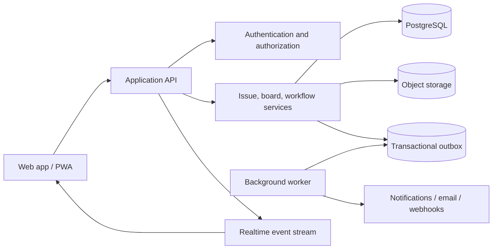
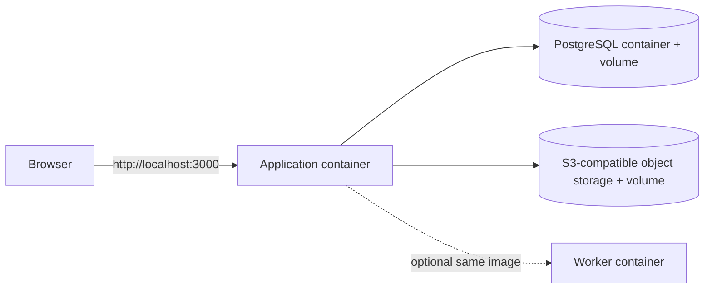

# Vibe JIRA — Implementation Plan

## 1. Product intent

Build a fast, self-hostable project and issue management application inspired by the useful parts of JIRA, with the Kanban board as the primary workspace. The product should feel simpler and more immediate than enterprise JIRA while still supporting serious team workflows.

Working product name: **Vibe JIRA**. Before public release, choose original branding and avoid copying Atlassian trademarks, visual assets, or proprietary UI details.

### Product principles

1. The board is the product, not an add-on.
2. Common actions should be possible without leaving the current view.
3. Start opinionated; add configuration only where teams genuinely diverge.
4. Preserve an auditable history of every meaningful issue change.
5. Every major workflow must work with keyboard, mouse, and touch.
6. AI assistance may accelerate work, but deterministic rules own permissions, workflow transitions, and saved data.

## 2. Working assumptions

- Initial target: small-to-medium software and engineering teams.
- Delivery model: browser-based responsive web UI. No desktop application or locally installed client is required. PWA installation can be added later.
- Tenancy: one organization per installation in the first release; schema remains ready for multiple organizations.
- Authentication: email/password for local development, then managed OAuth/OIDC for production.
- Deployment: one versioned Docker application image, with PostgreSQL and object storage kept as separate persistent services. A supplied Docker Compose file starts the complete local/self-hosted stack.
- Recommended implementation: TypeScript throughout, React/Next.js for the web application, PostgreSQL for durable data, an ORM such as Prisma or Drizzle, and a Redis-compatible service only when jobs or realtime scale require it.
- Exact framework and dependency versions should be selected and pinned at project creation time rather than embedded in this plan.

### 2.1 Language decision

**Primary language: TypeScript in strict mode.**

Use TypeScript for the browser UI, server/API, domain rules, realtime event handling, background jobs, seed tools, and automated tests. This keeps shared contracts such as issues, transitions, board filters, permissions, and API errors consistent across the entire application and gives AI-assisted changes a smaller, more coherent surface to modify.

Supporting languages and formats:

- SQL for PostgreSQL migrations, indexes, constraints, and carefully reviewed reporting queries
- HTML and CSS through the React UI and design system
- YAML for Docker Compose and CI configuration
- Dockerfile syntax for the production image
- Shell only for small container entrypoints; application logic must not live in shell scripts

Recommended language stack:

| Layer | Choice |
|---|---|
| Web UI | TypeScript + React |
| Full-stack web framework | Next.js |
| API and domain services | TypeScript on Node.js |
| Background jobs | TypeScript on Node.js, packaged in the same image |
| Database | PostgreSQL with explicit SQL migrations through the selected TypeScript data layer |
| Unit/integration tests | TypeScript |
| Browser tests | TypeScript + Playwright |

Required compiler policy: enable `strict`, `noImplicitAny`, and `strictNullChecks`; validate all untrusted runtime input because TypeScript types are removed at runtime. Do not use `any` to bypass contract errors. Generate or share API schema types so the client and server do not maintain duplicate handwritten models.

The main alternative is C#/.NET for the API with TypeScript/React for the UI. Choose that split only if the implementation team is substantially stronger in .NET or requires deep Microsoft enterprise integration. For this greenfield, AI-assisted, Kanban-first product, one TypeScript codebase is the simpler default.

## 3. Scope and release strategy

### Release 1 — Usable Kanban MVP

A team can create a project, define a board, create and edit issues, drag them through a workflow, collaborate, filter work, and recover a complete activity trail.

Required capabilities:

- Organization, users, teams, and project membership
- Projects with generated issue keys such as `ENG-142`
- Issue types: Epic, Story, Task, Bug, Subtask
- Issue fields: summary, description, status, priority, assignee, reporter, labels, estimate, due date, parent, and attachments
- Configurable workflow statuses grouped into To Do, In Progress, and Done categories
- Kanban board with drag-and-drop transitions and optimistic UI
- Backlog/list view
- Issue detail drawer plus dedicated issue URL
- Comments, mentions, watchers, and activity history
- Search and saved filters
- Basic role-based access control
- In-app notifications
- Project settings and workflow configuration
- CSV import and export
- Responsive and accessible UI
- Automated testing, backups, logging, and deployment documentation

### Release 2 — Team planning

- Sprints and Scrum board mode
- Versions/releases and milestones
- Components and ownership rules
- Custom fields and field layouts
- Reusable workflow templates
- Automation rules
- Email notifications and inbound email issue creation
- Webhooks and public API tokens
- Dashboards and richer reports
- Bulk edit and bulk transitions
- Git provider links for branches, commits, and pull requests

### Release 3 — Enterprise and ecosystem

- Multi-organization SaaS tenancy
- SAML/OIDC SSO, SCIM, and advanced audit controls
- Marketplace/plugin boundary
- Advanced permission schemes and issue security levels
- Cross-project roadmaps and dependency planning
- Service-management queues and SLAs
- Data residency, retention policies, and compliance controls
- Mobile applications only if the PWA is insufficient

### Explicit non-goals for Release 1

- Pixel-for-pixel JIRA compatibility
- Supporting every possible workflow condition or validator
- A generalized no-code application platform
- Portfolio planning, service desk, asset management, or billing
- AI-generated transitions that bypass permissions or validation

## 4. Primary users and critical journeys

### Contributor

- Open the board and immediately understand current work.
- Create an issue in a column with minimal fields.
- Drag an issue to a valid next status.
- Open an issue without losing board context.
- Comment, mention a teammate, attach a file, and follow changes.

### Project lead

- Configure columns, statuses, work-in-progress limits, and swimlanes.
- Triage backlog items and assign owners.
- Filter the board and save reusable views.
- See cycle time, throughput, aging work, and blocked work.

### Administrator

- Invite and deactivate users.
- Control roles and project access.
- Inspect audit events and system health.
- Export data and restore from backup.

## 5. Functional specification

### 5.1 Kanban board

The board is a projection of issues selected by a saved filter and grouped by mapped workflow statuses.

Core behavior:

- Columns may map to one or more statuses.
- Cards can be ordered within a column using fractional ranking values.
- Dragging validates the workflow transition on the server.
- Optimistic movement is rolled back with a clear message if validation fails.
- Concurrent edits are detected with a record version or update timestamp.
- Board filters include assignee, type, priority, label, epic, and free text.
- Quick filters can be configured per board.
- Swimlanes initially support none, assignee, and epic.
- WIP limits produce a warning in Release 1; hard enforcement is optional later.
- The UI provides equivalent keyboard controls for card movement.
- Virtualize large columns and paginate/filter on the server for very large boards.

Board acceptance criteria:

- A successful card move persists after refresh and creates one transition history event.
- Invalid transitions never produce partial state.
- Two users viewing the same board see a committed update within a few seconds.
- A board with 1,000 matching issues remains usable; the UI does not render all cards at once.
- Every drag action has an accessible non-drag alternative.

### 5.2 Issues

- Stable internal UUID plus human-readable project key/sequence.
- Markdown or structured rich-text description with sanitized rendering.
- Inline field editing with explicit save state and error recovery.
- Parent/child rules enforced by issue type.
- Soft delete with administrative restoration; permanent deletion is restricted.
- Immutable event log for creation, field changes, transitions, comments, and attachment actions.
- Attachments stored outside the database using signed access URLs.

### 5.3 Workflows

- A workflow contains statuses and allowed directed transitions.
- Statuses have a stable ID, display name, color, and one of three categories.
- A transition may later gain conditions, validators, and post-actions.
- Release 1 ships a default workflow: Backlog → Selected → In Progress → Review → Done, with sensible reverse transitions.
- Editing an active workflow must prevent orphaned issues and require an explicit migration when removing a used status.

### 5.4 Search and filters

Release 1 uses a friendly filter builder backed by a documented internal query model. Do not attempt full JQL compatibility initially.

Supported predicates:

- Project, type, status, status category, priority, assignee, reporter
- Label, parent/epic, created date, updated date, due date
- Full-text summary and description search
- AND across groups, OR within multi-select values
- Sort by rank, priority, created, updated, due date, or key

Filters can be private, shared with a project, or shared with the organization.

### 5.5 Collaboration and notifications

- Threaded depth is unnecessary in Release 1; comments remain chronological.
- Mentions and watcher events produce in-app notifications.
- Notification preferences are per user and event class.
- Realtime board updates use Server-Sent Events or WebSockets; select the simpler operational option during implementation.
- Presence indicators are optional and must not block the core release.

### 5.6 Reporting

Release 1:

- Cumulative flow diagram
- Throughput by week
- Cycle time and lead time distributions
- Aging work-in-progress list
- Created versus resolved trend

All metrics need written definitions and tests. In particular, time in status should be derived from transition events, not the issue's current row alone.

### 5.7 Administration

- Organization settings
- User invitation, activation, deactivation, and role assignment
- Project templates and project archiving
- Audit log with actor, action, target, timestamp, and request correlation ID
- Import/export status and error reports
- Retention and backup documentation

## 6. Permission model

Use additive project roles in Release 1:

| Role | Typical rights |
|---|---|
| Organization admin | Manage organization, users, all projects, audit, and exports |
| Project admin | Configure one project, board, workflow, roles, and imports |
| Member | Browse, create, edit, comment, attach, and transition |
| Viewer | Browse and comment if explicitly enabled |

Enforce authorization in the server/service layer for every read and write. Hiding a UI control is not authorization.

Permission checks should be expressed as named capabilities such as `issue:create`, `issue:transition`, `project:admin`, and `audit:read`. This keeps route handlers and UI logic independent from role names.

## 7. Proposed architecture



Start as a modular monolith. Keep clear domain boundaries, but avoid distributed services until scale or team ownership makes them necessary.

### 7.1 Web UI requirements

- The entire product is operated through a standards-based web browser.
- The application container serves the UI and versioned API from one origin by default, avoiding unnecessary cross-origin configuration.
- The UI is responsive across desktop, tablet, and practical mobile widths, with desktop optimized for dense board work.
- Every project, board, filter, and issue has a stable deep link that survives refresh and can be shared.
- Board state such as the selected project, active filters, swimlane, and open issue drawer is reflected in the URL where useful.
- Server-rendered or statically optimized entry pages may be used, but all critical workflows must remain functional after direct navigation to a deep URL.
- No feature may depend on Electron, a native desktop bridge, a browser extension, or access to the host filesystem.
- Current evergreen Chrome, Edge, Firefox, and Safari are the supported Release 1 browsers.
- The web UI must surface connection loss, stale data, rejected optimistic updates, and server maintenance states clearly.
- Runtime deployment settings must come from environment variables or a generated public runtime-config endpoint; rebuilding the image should not be required to change the public URL or identity provider.

### 7.2 Docker delivery model

Release 1 produces one immutable application image. The same image can start the web process, a migration command, or an optional background worker through different container commands. This prevents separate web and worker builds from drifting.

Minimum image requirements:

- Multi-stage build with development dependencies excluded from the runtime image
- Runs as a non-root user
- Listens on `0.0.0.0` with a configurable port, defaulting to `3000`
- Configuration supplied through environment variables and Docker secrets; no secrets baked into image layers
- `/health/live` and `/health/ready` endpoints used by Docker and orchestrators
- Graceful shutdown on `SIGTERM`, including stopped intake and completed/abandoned database transactions
- Structured logs written to stdout/stderr
- Read-only root filesystem compatible, with only an explicit temporary directory writable
- Image version and source revision exposed in health/build information
- Container image scanned in CI and published with immutable semantic-version and commit tags
- Database migrations run as an explicit one-shot command before the new application starts; they do not silently run in every web replica

The default self-hosted developer/demo topology is:



The repository must include:

- Production `Dockerfile`
- `.dockerignore`
- `compose.yaml` for the complete local/self-hosted stack
- `compose.override.yaml` or a development profile for hot reload
- `.env.example` containing safe placeholders only
- Entrypoint commands for web, worker, migration, and seed/demo data
- Named volumes for PostgreSQL and local object storage
- Documented backup, restore, upgrade, rollback, and image-pinning procedures

Required operator experience:

```text
copy .env.example to .env
docker compose up --build
open http://localhost:3000
```

For production, the application container remains stateless. PostgreSQL must never be embedded in the application image. Attachments use external S3-compatible storage, and TLS terminates at a reverse proxy, ingress, or managed load balancer. A small demonstration installation may run the worker loop inside the application process, but the same image must support separating it into a worker container without changing application code.

Suggested modules:

- Identity and organization
- Projects and membership
- Issues and relationships
- Workflows and transitions
- Boards, ranking, and filters
- Comments, mentions, watchers, and attachments
- Notifications and realtime delivery
- Search
- Reporting
- Import/export
- Audit and administration

### Write path for a board transition

1. Client sends issue ID, transition ID, destination status, destination position (the neighboring issue IDs it was dropped between), and known record version.
2. Server authenticates user and checks `issue:transition`.
3. Workflow service validates the current state and requested transition.
4. A database transaction computes the rank from the destination neighbors, updates status/rank/version, appends history, and writes an outbox event. Clients never supply rank values, and ranks keep exact decimal precision end to end.
5. API returns the canonical updated issue.
6. Worker publishes notifications and realtime invalidation from the outbox.
7. Other clients refresh the affected card/columns.

## 8. Initial data model

Every tenant-owned table should carry `organization_id`, even if Release 1 runs one organization per installation.

| Entity | Important fields and relationships |
|---|---|
| Organization | id, name, slug, settings |
| User | id, email, display_name, avatar, state |
| Membership | organization_id, user_id, organization_role |
| Team | id, organization_id, name; many-to-many users |
| Project | id, organization_id, key, name, sequence_counter, archived_at |
| ProjectMember | project_id, user_id/team_id, role |
| IssueType | id, project/template scope, name, hierarchy_level |
| Issue | id, project_id, number, type_id, status_id, summary, description, priority, reporter_id, assignee_id, parent_id, rank, version, timestamps |
| Workflow | id, project/template scope, name, version, active |
| Status | id, workflow_id, name, category, position |
| Transition | id, workflow_id, from_status_id, to_status_id, name |
| Board | id, project_id, name, filter_id, board_type, settings |
| BoardColumn | id, board_id, name, position, wip_limit |
| ColumnStatus | board_column_id, status_id |
| Filter | id, owner_id, project_id, visibility, query_json, sort_json |
| Label | id, organization_id, normalized_name, display_name |
| IssueLabel | issue_id, label_id |
| Comment | id, issue_id, author_id, body, edited_at, deleted_at |
| Watcher | issue_id, user_id |
| Attachment | id, issue_id, uploader_id, object_key, filename, content_type, size, scan_state |
| IssueEvent | id, issue_id, actor_id, event_type, payload_json, created_at |
| Notification | id, recipient_id, event_id, read_at, delivery_state |
| SavedView | optional alias or extension of Filter for user UI state |
| AuditEvent | id, actor_id, action, target_type/id, metadata, correlation_id, created_at |
| OutboxEvent | id, topic, aggregate_id, payload, attempts, published_at |

Important constraints:

- Unique `(project_id, number)` and unique organization-scoped project key.
- Self-parenting and cyclic parent relationships are forbidden.
- Status must belong to the project's active workflow.
- Rank updates and status transitions occur in one transaction.
- User deactivation never removes historical attribution.

## 9. API surface

Use a versioned JSON API. REST is the simplest default; typed client generation can provide most of the developer-experience benefits often associated with GraphQL.

Representative endpoints:

- `POST /api/v1/projects`
- `GET /api/v1/projects/{projectKey}`
- `GET|POST /api/v1/projects/{projectKey}/issues`
- `GET|PATCH /api/v1/issues/{issueKey}`
- `POST /api/v1/issues/{issueKey}/transitions`
- `GET|POST /api/v1/issues/{issueKey}/comments`
- `POST /api/v1/issues/{issueKey}/attachments`
- `GET /api/v1/boards/{boardId}`
- `GET /api/v1/boards/{boardId}/issues`
- `PATCH /api/v1/boards/{boardId}/rank`
- `GET|POST /api/v1/filters`
- `GET /api/v1/search/issues`
- `GET /api/v1/reports/{reportType}`
- `GET /api/v1/events/stream`

API requirements:

- Machine-readable validation errors with stable codes
- Cursor pagination
- Idempotency keys for vulnerable create/import operations
- Optimistic concurrency using version/ETag semantics
- Request correlation IDs in logs and audit events
- Rate limiting on authentication, search, upload, and export endpoints
- OpenAPI document generated and checked in CI

## 10. Frontend information architecture

Global navigation:

- Your work
- Projects
- Filters
- Dashboards (Release 2)
- Search
- Create issue
- Notifications
- Administration, when authorized

Project navigation:

- Board
- Backlog
- Issues
- Reports
- Project settings

Key UI components:

- Board shell, toolbar, filters, swimlanes, columns, and virtualized card lists
- Issue card with compact, configurable metadata
- Issue create dialog optimized for keyboard entry
- Issue detail drawer that keeps the underlying board state and URL synchronized
- Activity timeline and comment composer
- Workflow editor with safeguards around active data
- Filter builder with a readable query summary
- Empty, loading, partial-error, offline, and permission-denied states

## 11. Engineering standards

### Repository layout

```text
apps/
  web/            # UI and HTTP endpoints
  worker/         # asynchronous jobs; packaged from the same image
packages/
  domain/         # business rules and capability checks
  database/       # schema, migrations, repositories
  ui/             # design system
  contracts/      # API schemas and generated types
  observability/  # logging, metrics, tracing helpers
infra/
  docker/         # container entrypoints and runtime configuration
docs/
```

A single application image that can run the web application or worker is enough initially. A monorepo is useful because contracts, UI primitives, and domain types are shared.

### Quality gates

- Formatter, linter, type checking, unit tests, integration tests, and production build in CI
- Migration checks against a clean database and an upgraded previous schema
- Applied migrations are immutable; every schema change ships as a new migration file
- Integration suites fail in CI, rather than skip, when their database is unavailable
- No merge when critical accessibility checks or authorization tests fail
- Dependency and container vulnerability scanning
- Preview environment for each pull request when practical
- Seed script with realistic demo organization, project, users, and issues

### Definition of done

A story is done only when:

- Acceptance criteria pass.
- Permission behavior is tested.
- Empty, loading, and error states are handled.
- Keyboard and screen-reader behavior is considered.
- Audit/history behavior is correct.
- Telemetry contains no sensitive content.
- API and user-facing documentation are updated.

## 12. Testing strategy

### Unit tests

- Workflow transition rules
- Capability resolution
- Ranking and rebalance logic
- Query/filter translation
- Parent/child and issue-key constraints
- Report metric calculations

### Integration tests

- Database transactions and concurrency conflicts
- Full issue lifecycle and history generation
- Outbox delivery and retry behavior
- Attachment authorization and scan state
- CSV import validation, partial failures, and idempotency

### End-to-end tests

- Create project → create issues → configure board → move cards → verify refresh
- Invalid drag rolls back cleanly
- Mention generates exactly one notification
- Project admin can configure; member and viewer cannot
- Search/filter/share workflow
- User deactivation preserves attribution but blocks access
- Mobile viewport and keyboard-only board operation

### Non-functional tests

- Load test board queries, search, bulk import, and realtime fan-out
- Accessibility audit targeting WCAG 2.2 AA
- Backup restoration drill
- Threat modeling and authorization boundary tests
- Cross-browser coverage for current evergreen browsers

## 13. Security and reliability baseline

- Secure, HTTP-only session cookies with CSRF protection, or an equivalently safe managed identity flow
- Password hashing with a modern memory-hard algorithm if passwords are stored locally
- Central authorization middleware plus domain-level capability checks
- HTML sanitization for all rich text
- Strict upload size/type rules, malware scanning, and private object storage
- Secrets held outside source control
- Encryption in transit and at rest
- Tenant scoping enforced in repository queries and tested for data leakage
- Tamper-resistant audit history with retention controls
- Point-in-time database recovery where supported
- Graceful job retry with a dead-letter state and administrative visibility
- Structured logs, error tracking, metrics, traces, readiness, and liveness endpoints

Initial service objectives:

- 99.9% monthly availability after production stabilization
- p95 board read under 500 ms at the API boundary under expected load
- p95 ordinary issue update under 400 ms, excluding file processing
- No acknowledged data loss for committed issue updates

## 14. Delivery roadmap

Estimates assume a small team using AI-assisted development with active human review. Treat them as planning ranges, not promises.

### Phase 0 — Product and technical foundation (1 week)

- Confirm personas, hosting model, and Release 1 boundary
- Record architecture decisions
- Scaffold repository, production Dockerfile, Docker Compose stack, CI, migrations, observability, and seed data
- Prove a clean-machine startup with `docker compose up --build` and browser access through the published application port
- Establish design tokens and the accessible component baseline
- Deliver: deployable skeleton, health checks, sign-in shell, seeded database

### Phase 1 — Identity, projects, and issues (2 weeks)

- Organization/user/project models and membership
- Project creation and issue key generation
- Issue CRUD, types, priorities, labels, parent relationships
- Issue page/drawer, activity events, and permission framework
- Deliver: complete issue lifecycle without board drag-and-drop

### Phase 2 — Workflow and Kanban core (2 weeks)

- Statuses, transitions, board columns, ranking
- Board query, cards, drag-and-drop, keyboard movement
- Optimistic concurrency, realtime invalidation, WIP warnings
- Deliver: production-quality core Kanban journey

### Phase 3 — Collaboration and finding work (2 weeks)

- Comments, mentions, watchers, notifications, attachments
- Search, filter builder, saved filters, quick filters, backlog/list view
- Deliver: team-ready daily workflow

### Phase 4 — Administration, reports, and portability (2 weeks)

- User/project administration and audit log
- CSV import/export and background jobs
- Kanban reports and metric validation
- Workflow configuration safeguards
- Deliver: operationally usable Release 1 feature set

### Phase 5 — Hardening and launch (1–2 weeks)

- Accessibility and responsive polish
- Performance, load, security, and recovery testing
- Documentation, deployment runbook, demo data, and onboarding
- Bug burn-down and release candidate validation
- Deliver: Release 1

Likely total: 10–11 weeks for a small experienced team. A solo AI-assisted builder should plan by feature gates rather than calendar time and expect integration/polish to take at least as much effort as initial code generation.

## 15. Epic backlog for Release 1

| Epic | Outcome | Exit test |
|---|---|---|
| E1 Foundation | Repeatable local and hosted environments | New developer reaches a seeded app from documented steps |
| E2 Identity and access | Users see and change only authorized data | Capability matrix passes at API and UI layers |
| E3 Projects and issues | Teams can model and manage work | Full issue lifecycle persists with correct history |
| E4 Workflow engine | Projects control valid state changes | Invalid paths are rejected atomically |
| E5 Kanban board | Teams manage flow visually | Board movement is fast, accessible, concurrent, and durable |
| E6 Collaboration | Work has discussion, files, and awareness | Mentions/watchers notify once and respect preferences |
| E7 Search and views | Users can quickly locate relevant work | Complex supported filters return stable, paginated results |
| E8 Administration | Admins can operate the installation | Users/projects/audit/import/export function under RBAC |
| E9 Reporting | Leads can inspect delivery flow | Metrics reproduce known fixture calculations |
| E10 Production readiness | System can be safely launched | Security, load, accessibility, backup, and recovery gates pass |

## 16. Vibe-coding execution protocol

AI-assisted development works best when each unit is small, testable, and constrained by existing contracts.

For every story:

1. State the user outcome, non-goals, acceptance tests, permission rules, and affected data.
2. Ask the coding agent to inspect relevant modules before proposing edits.
3. Implement a vertical slice: schema/domain/API/UI/tests, not a disconnected UI mock.
4. Run formatting, types, focused tests, then the broader suite.
5. Inspect the diff for accidental scope, insecure shortcuts, duplicated concepts, and missing migrations.
6. Exercise the feature in the browser at desktop and narrow viewport sizes.
7. Update the decision log when a lasting technical choice is made.
8. Commit only after the acceptance test is demonstrably satisfied.

Prompt template:

```text
Implement [story] for Vibe JIRA.

User outcome:
[one observable outcome]

Acceptance criteria:
- ...

Permission rules:
- ...

Constraints/non-goals:
- ...

Before editing, inspect the existing architecture and tests. Reuse established
patterns. Implement the smallest complete vertical slice, add tests, run the
relevant quality gates, and report changed files, verification results, and any
remaining risks. Do not weaken types, authorization, validation, or tests to make
the change pass.
```

Human review is mandatory for:

- Authentication and authorization
- Database migrations and destructive operations
- File uploads and rich-text rendering
- Workflow/ranking concurrency
- Tenant isolation
- Public API and webhook behavior
- Backup, restore, and deployment changes

## 17. Key technical risks and mitigations

| Risk | Mitigation |
|---|---|
| Scope expands toward all of JIRA | Release gates, explicit non-goals, and one primary persona for MVP |
| Drag-and-drop hides invalid state | Server-owned transitions, atomic writes, optimistic rollback |
| Card ranking degrades after many moves | Fractional ranks with monitored/retry-safe rebalance job |
| Realtime creates duplicate or stale UI | Idempotent events, canonical API response, version comparison, refetch fallback |
| Permissions leak data through search/reports | Apply tenant/project scope before filters and aggregation; adversarial tests |
| Custom fields destabilize the schema | Defer to Release 2; design a typed field-value model before implementation |
| Reporting definitions are disputed | Publish metric definitions and test with dated transition fixtures |
| AI-generated code increases inconsistency | Architecture boundaries, small stories, quality gates, diff review, ADRs |
| Imports corrupt or partially duplicate data | Dry run, validation report, idempotency keys, transaction boundaries, rollback plan |
| A monolith becomes tangled | Modular domain packages, dependency rules, and service ownership boundaries |

## 18. Decisions required before coding

Resolve these during Phase 0:

1. Self-hosted only, hosted SaaS, or both?
2. Single organization per installation for Release 1?
3. Managed authentication provider or application-owned identity?
4. REST plus generated client, or another API approach?
5. SSE or WebSockets for live board invalidation?
6. Markdown or structured rich text?
7. PostgreSQL native search first, or a separate search service from day one?
8. Cloud-neutral object storage interface and initial provider?
9. Required import compatibility: generic CSV only, or JIRA export mapping?
10. Required deployment target and operational budget?

Recommended defaults: browser-only UI; one application image; Docker Compose for self-hosting; external PostgreSQL and S3-compatible storage; both self-hosted and hosted-ready; single organization in Release 1; managed authentication; REST/OpenAPI; SSE; Markdown with safe preview; PostgreSQL search; generic CSV plus documented JIRA CSV mapping.

## 19. Release 1 acceptance gate

Release 1 is ready only when a clean environment can demonstrate all of the following:

1. An admin creates a project, invites members, and assigns roles.
2. A member creates a mixed hierarchy of issues and attaches supporting material.
3. A project admin configures statuses, transitions, board columns, quick filters, and a WIP limit.
4. Two concurrent users move and edit cards without silent lost updates.
5. Invalid or unauthorized transitions are rejected with no partial history.
6. Users comment, mention, watch, search, filter, and receive correct notifications.
7. Leads view validated Kanban metrics from the event history.
8. Admins inspect audit events and complete an import/export.
9. Automated checks cover the critical permission, workflow, accessibility, and data paths.
10. Backup restoration and rollback procedures have been successfully exercised.
11. A clean host with Docker can launch the full stack from the documented environment template, and the UI is usable at the configured browser URL.
12. Recreating or upgrading the application container preserves all database records and attachments stored in persistent services.

## 20. First implementation slice

The first slice should prove the architecture without prematurely building breadth:

**Story:** A signed-in user creates a project, creates a task, sees it on a three-column board, moves it from To Do to In Progress, and sees the transition in its activity history after refreshing.

This slice should include:

- Organization, user, project, membership, issue, workflow, status, transition, board, column, rank, and issue-event tables
- Capability checks for viewing, creating, and transitioning
- Seeded default workflow and board
- Project creation and issue creation UI
- Board read model and minimal accessible card movement
- Atomic transition/history transaction
- One concurrency test, one authorization test, and one browser-level happy-path test
- A production Dockerfile and Compose stack that run the slice from a clean checkout
- Container health checks, explicit migration command, persistent database volume, and browser-accessible port

Do not add comments, attachments, custom fields, reporting, or elaborate administration until this slice is reliable. It will expose the hardest architectural seams early: identity, tenancy, workflow correctness, ranking, API contracts, event history, and UI synchronization.
